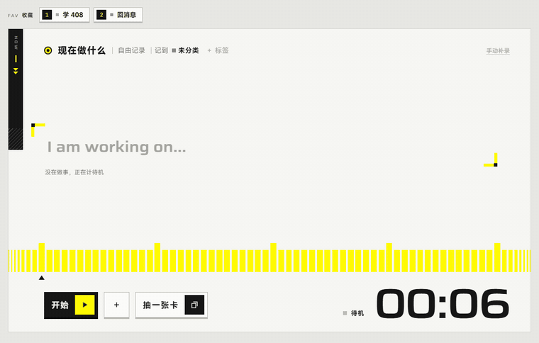
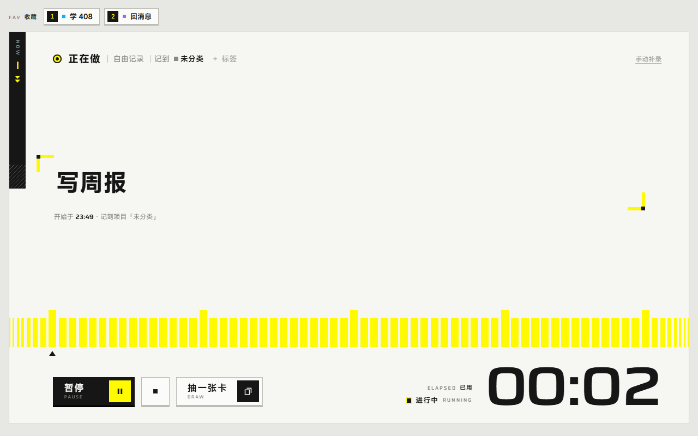
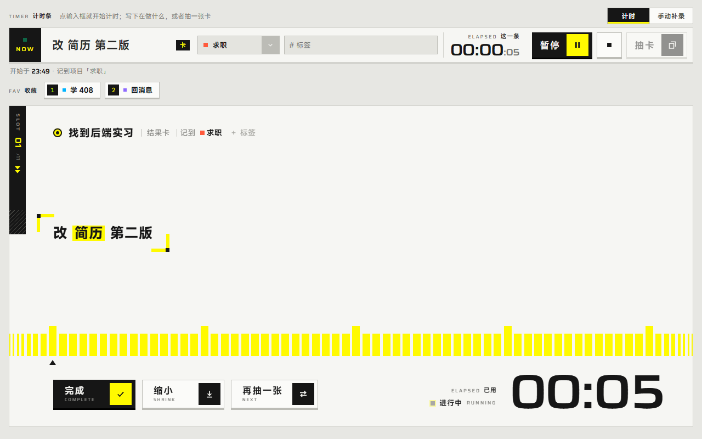
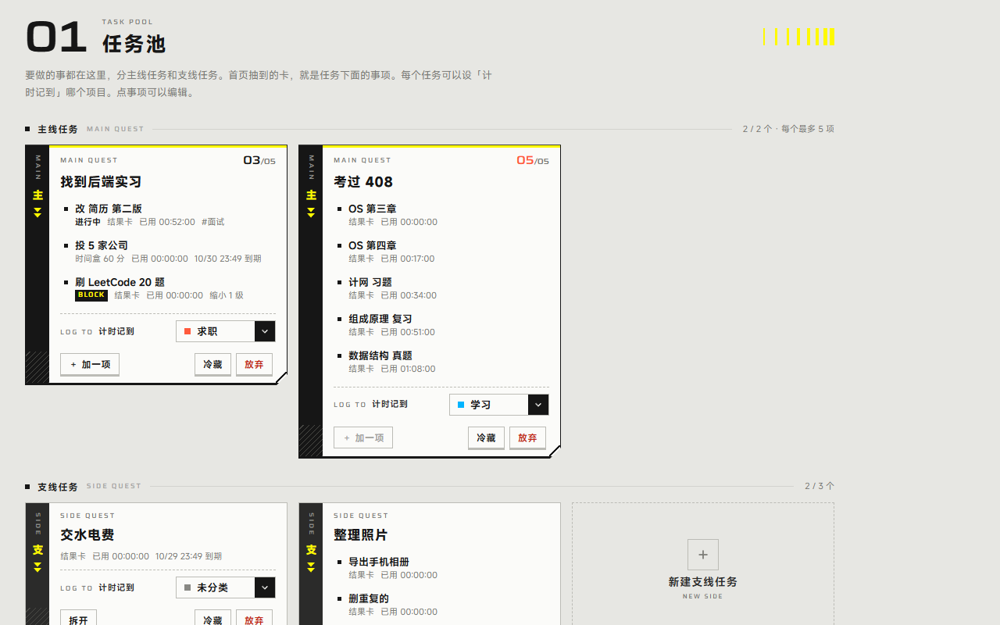
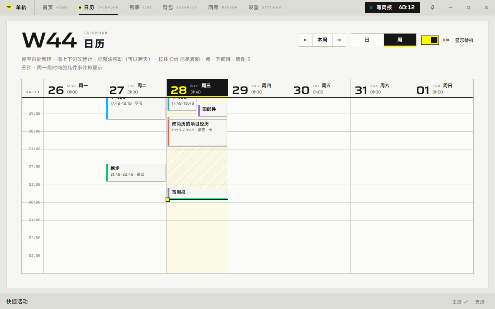
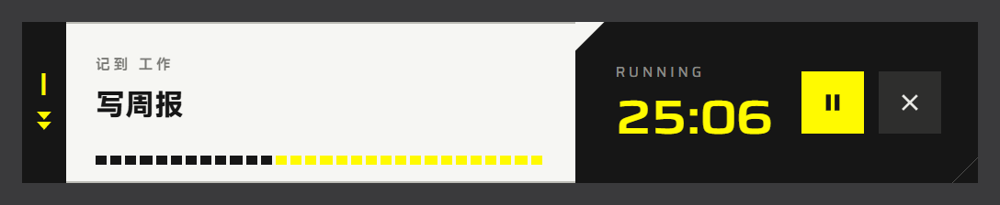

# 单轨 MONORAIL

[](https://github.com/kai-wei-kfuse/monorail/releases/latest)


[](https://github.com/kai-wei-kfuse/monorail/actions/workflows/release.yml)

注：现在还处于项目的雏形，需要经过大量使用调整，所以现在并不是最终状态。

一个 Windows 桌面上的「现在做什么」：写下手头的事就开始计时，不知道做什么就从任务池里抽一张卡。所有时间都落成可以改的条目，数据是本地的 Markdown 文件。



## 主要功能

**计时就是首页。** 点输入框就开始计时，写下在做什么、选项目和标签就确认；暂停可以〔继续〕接回来，停止就回到待机。读数点一下能直接改，`45`、`1:30`、`+10` 都认。常用的事存成收藏，数字键 1–9 一键开始。



**抽卡做事。** 要做的事按主线、支线任务放进任务池，每项是一张卡。首页抽到哪张做哪张，可以完成、缩小、再抽一张；卡上的时间单独累计，中途去厕所、吃饭不算在内。

| 做卡中（分开布局） | 任务池 |
|---|---|
|  |  |

**日历和列表。** 一周的时间块一目了然，拖动就能新建、移动、改起止；列表按天合并同名记录。忘了计的那段可以手动补录。



**小窗。** 独立的置顶小窗，和主窗口同时开着，能暂停、继续、完成，点名字改名称，点读数改时间。



另外还有：快速记录条（全局快捷键，主窗口隐藏时也能存一条待办）、到期提醒、休息池、每周回顾、睡眠和离线时段追问、开机自启、应用内更新。

## 安装与开发

- 安装：从 [Releases](https://github.com/kai-wei-kfuse/monorail/releases) 下载 `monorail_<版本>_windows-x86_64_setup.exe`。应用内更新经本机 GitHub CLI 读取 Release，需要先 `gh auth login`，见 [docs/updates.md](docs/updates.md)。
- 开发：Node 24 + Rust 1.95.0（MSVC）+ WebView2。

  ```powershell
  npm ci
  npm run check                                   # tsc → eslint（分层、无环）→ vitest
  npm run tauri -- build --debug --no-bundle      # 产物 src-tauri/target/debug/pixel-record.exe
  ```

- 技术栈：Tauri 2 + React 19 + TypeScript + zustand；数据是 Markdown + YAML，带 journal 的多文件事务。
- 分层和约定见 [CLAUDE.md](CLAUDE.md)，构建、验证和一致性细节见 [docs/开发说明.md](docs/开发说明.md)，发版说明在 [docs/releases/](docs/releases/)。

截图和动图由 [docs/assets/readme-shots.mjs](docs/assets/readme-shots.mjs) 从开发预览页（`gallery.html`，内存数据）生成。
