# 单轨 MONORAIL

[](https://github.com/kai-wei-kfuse/monorail/releases/latest)


[](https://github.com/kai-wei-kfuse/monorail/actions/workflows/release.yml)

注：现在还处于项目的雏形，需要经过大量使用调整，所以现在并不是最终状态。

一个 Windows 桌面上的「现在做什么」：前一晚或早上把要做的事排进今日任务板，犹豫时从板子上抽一张；写下手头的事就开始计时，途中插进来的事做完再回到原来那张。所有时间都落成可以改的条目，数据是本地的 Markdown 文件。

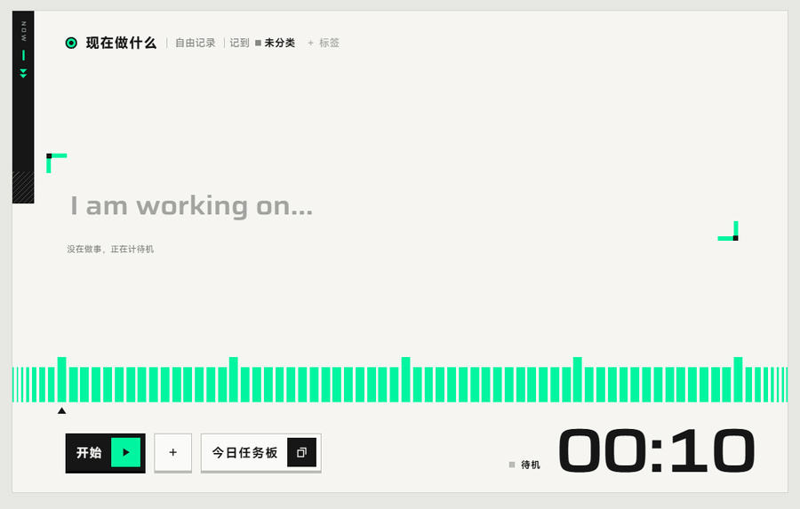

## 主要功能

**今日任务板和抽卡（0.3.1）。** 底栏〔背包〕从首页往上拉开抽屉，不换页面，计时照常走。左边是今日任务板，可以切到〔今天 | 明天〕，前一晚就能排明天；右边是主线、支线任务和想法池。排进今天时可以选优先级，时间盒卡还能填今天做多少分钟。犹豫时点〔抽一张〕：只从今天的板子上抽，标「高」的更容易抽到，卡背朝上摊开、洗一下再翻开，翻开的卡上不写概率。今天没做完的，第二天会问你带不带过去。

| 背包抽屉：今日任务板 + 任务 | 翻卡 |
|---|---|
| 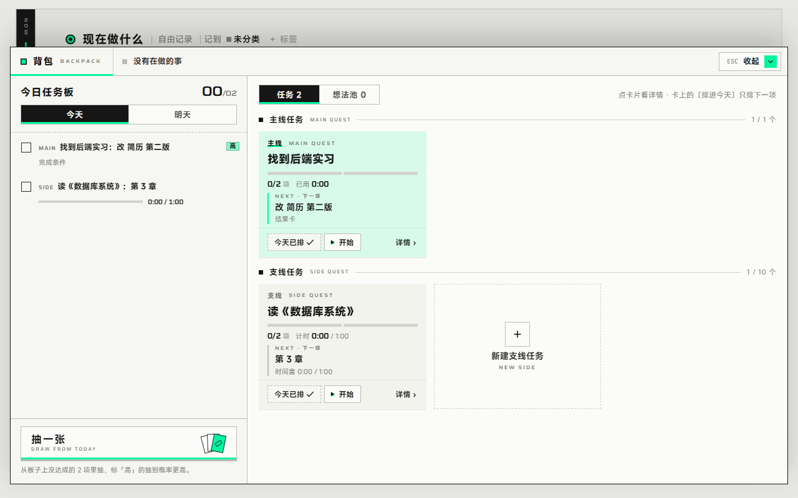 | 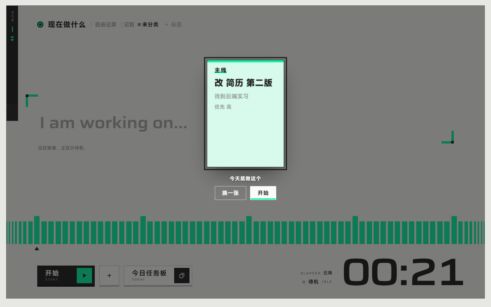 |

| 新建任务：每项可选结果卡或时间盒 | 排进今天：优先级和今天的量 |
|---|---|
| 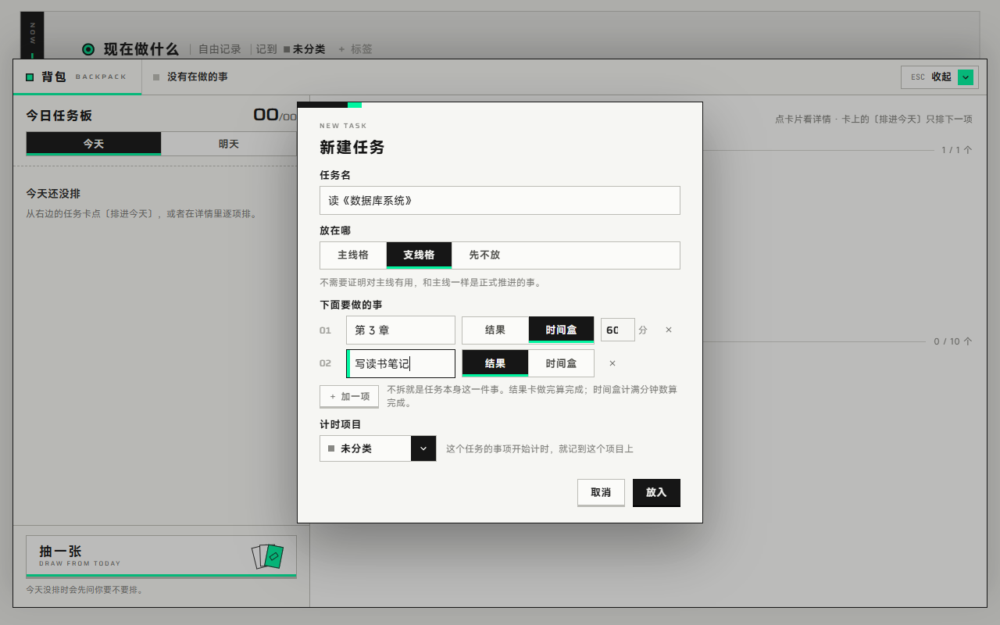 | 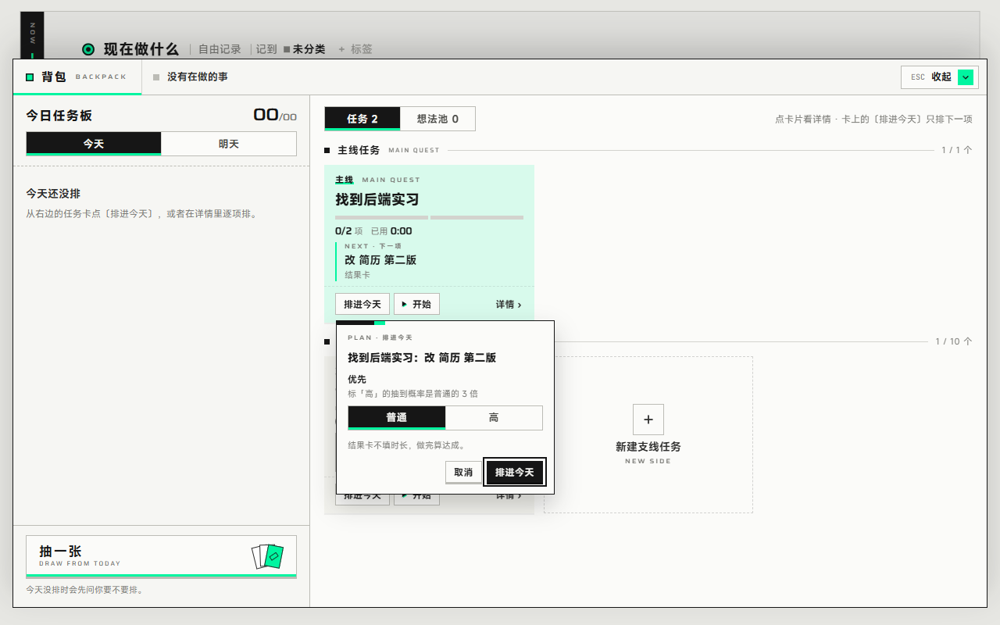 |

**插进来的事，做完回到原来那张（0.3.1）。** 做卡途中，从快捷活动、计时框、小窗、收藏或最近的记录开始别的事，都不会把卡放回去：插入卡盖在上面，原来那张退到后面等你，插进来的时间不算进卡。也可以点卡头〔插入事件〕，直接在落下的插入卡上写名字，按回车记下；Esc 撤回。插进来的事可以暂停、继续，也可以换成别的事；暂停后累计读数保留，改名或改项目时前面几段一起改。鼠标放到底边那条渐变上，左边是〔回到任务〕，卡接着计；右边是〔结束原任务〕，确认后卡放回背包，插进来的事接着计。底边还是顶边可以在设置里选。

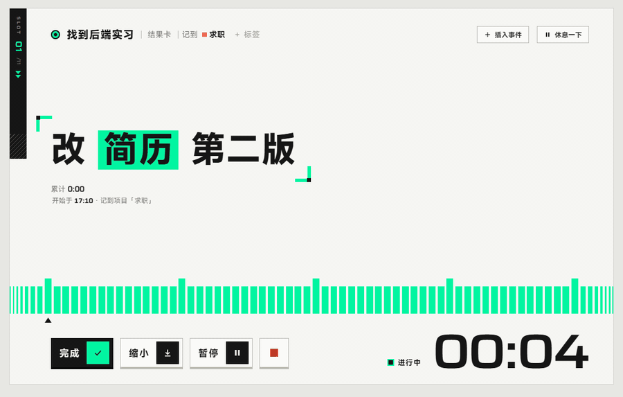

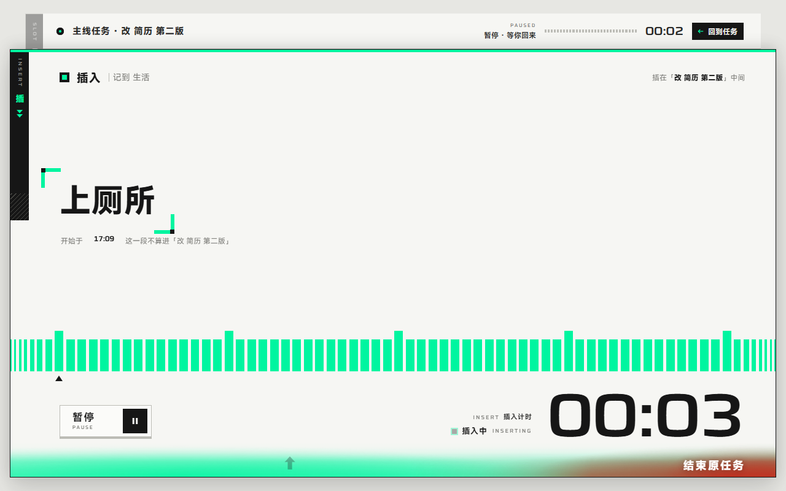

**首页做卡。** 大读数显示今天在这张卡上做了多久，和「今天 N 分钟」对得上，总累计写在标题下面；点读数可以直接改今天的时间。按钮是〔完成〕〔缩小〕〔暂停〕，卡头右上角有〔休息一下〕：插一段休息，卡等你回来。完成时可以选「还没做完，下次接着做」，这样还是同一张卡，进度接着算。

| 做卡中 | 缩小：拆成今天做的和剩下的 |
|---|---|
| 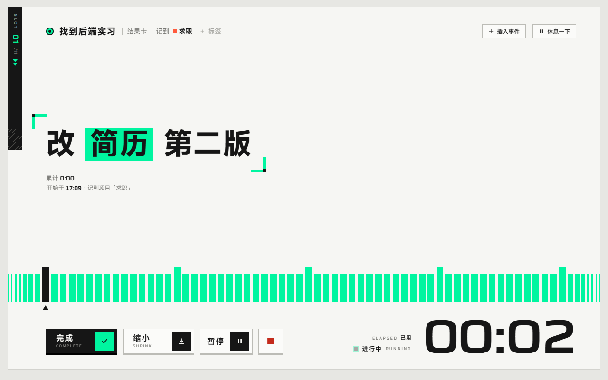 | 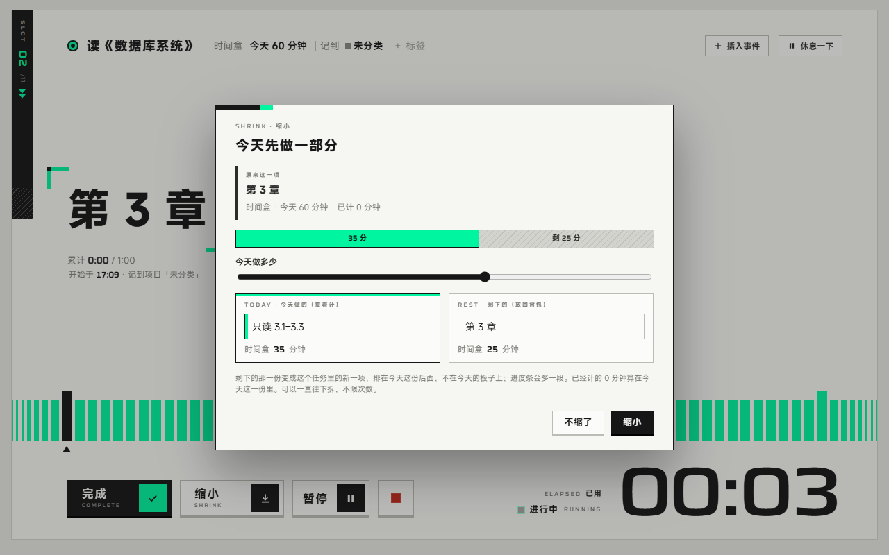 |

缩小就是把一张卡拆成两项：今天做的那份留在原位接着计，剩下的那份变成新的一项放回背包。时间盒卡用滑块分配分钟，可以一直往下拆。

**计时就是首页。** 点输入框就开始计时，写下在做什么、选项目和标签就确认；暂停后可以〔继续〕，停止就回到待机。读数点一下能直接改，`45`、`1:30`、`+10` 都认。常用的事存成收藏，数字键 1–9 一键开始。设置 04 可以选两种计时模式：**紧凑**记下每一分钟，待机久了会问刚才在做什么；**宽松**像 Toggl 一样想记就记，不显示待机，也不追问。两种模式存的数据一样，随时可以切换。

**日历和列表。** 一周的时间块一目了然，拖动就能新建、移动、改起止；列表按天合并同名记录。忘了计的那段可以手动补录。

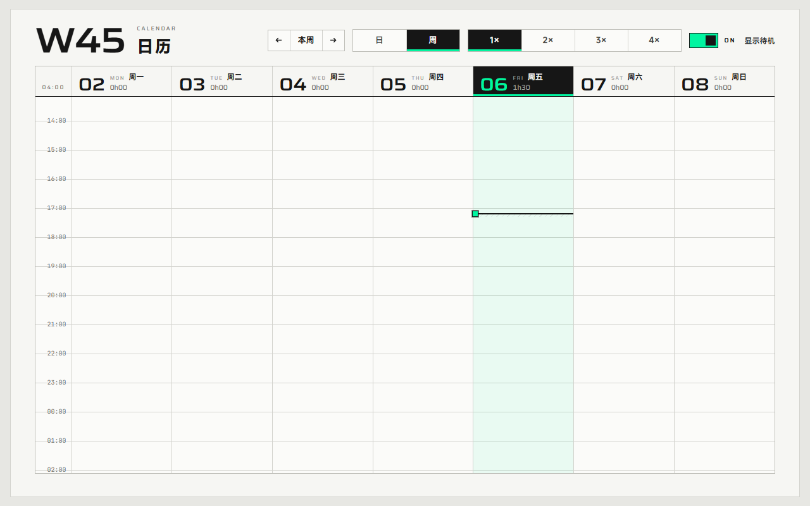

**小窗。** 独立的置顶小窗，和主窗口同时开着，能暂停、继续、完成，点名字改名称，点读数改时间。插入时小窗显示〔↩ 回到 …〕。

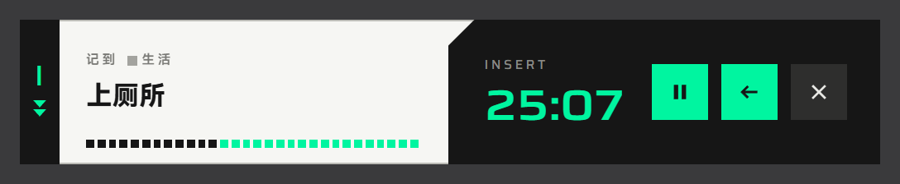

**AI 与自动化（MCP / CLI）。** 安装包内置本机 MCP 服务（`monorail-mcp.mjs`）与命令行工具（`monorail-cli.mjs`），供支持 MCP 的客户端、具备终端能力的 AI Agent 或脚本直接调用（需 Node.js 24+）。共提供 36 项共享应用方法（26 写、10 读）：读取当前状态、查看与编排今天/明天任务板、按权重抽卡与换一张、保存/完成/撤销完成想法、捕获待办、检索想法与任务卡、查看任务详情与整张完成/重新打开任务、完成/取消完成/接着做/拆分子任务卡片、开始 / 暂停 / 继续 / 停止计时、插入临时活动与返回或结束原任务、查询时间统计与多维度统计回看（`get_recap`）、读取操作历史（`list_operation_history`）、补录记录、修改已有记录（规则同日历，不能删除）。CLI 和 MCP 做不到的事，会提示 agent 停下来告诉用户，不要直接改数据文件。完成首次初始化后，即使关闭窗口或退出应用，调用时也会按需自动拉起本机后台。在「设置 → 09 AI 与自动化」可以直接复制当前安装路径对应的 MCP 配置与 PowerShell 命令，详见 [docs/application/README.md](docs/application/README.md) 与 [mcp/README.md](mcp/README.md)。

另外还有：快速记录条（全局快捷键，主窗口隐藏时也能存一条待办）、到期提醒、每周回顾、睡眠和离线时段追问（项目可以任选）、任务模式开关（关掉后只用计时，数据都留着）、开机自启、应用内更新（支持稳定版与 Beta 渠道切换）。

## 安装与开发

- 安装：从 [Releases](https://github.com/kai-wei-kfuse/monorail/releases) 下载 `monorail_<版本>_windows-x86_64_setup.exe`。应用内更新经本机 GitHub CLI 读取 Release，需要先 `gh auth login`，见 [docs/updates.md](docs/updates.md)。从 0.3.1 退回 0.3.0 不会损坏数据，今日任务板会被 0.3.0 忽略，再升回来时还在。
- 开发：Node 24 + Rust 1.95.0（MSVC）+ WebView2。

  ```powershell
  npm ci
  npm run check                                   # tsc → eslint（分层、无环）→ vitest
  npm run tauri -- build --debug --no-bundle      # 产物 src-tauri/target/debug/pixel-record.exe
  ```

- 技术栈：Tauri 2 + React 19 + TypeScript + zustand；数据是 Markdown + YAML，带 journal 的多文件事务。
- 分层和约定见 [CLAUDE.md](CLAUDE.md)，构建、验证和一致性细节见 [docs/开发说明.md](docs/开发说明.md)，发版说明在 [docs/releases/](docs/releases/)，0.3.1 的设计见 [ADR 0021](docs/adr/0021-today-plan-insert-split.md)。

截图和动图由 [docs/assets/readme-shots.mjs](docs/assets/readme-shots.mjs) 从开发预览页（`gallery.html?page=live`，内存数据加真 service）生成，不开真程序窗口。
