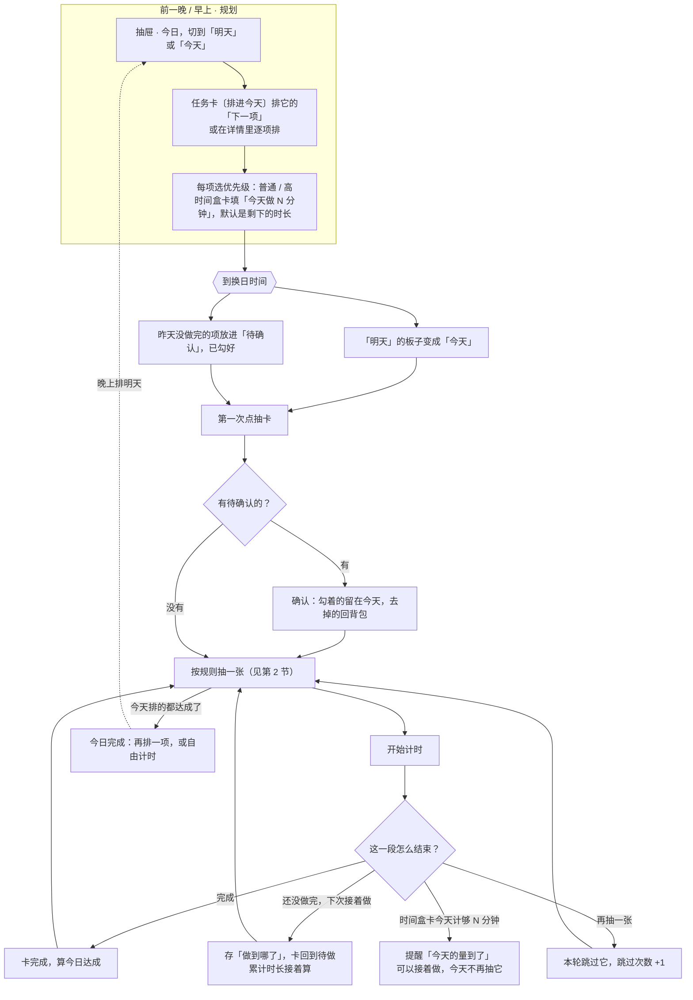
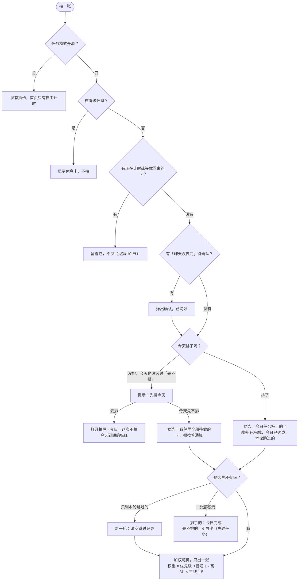
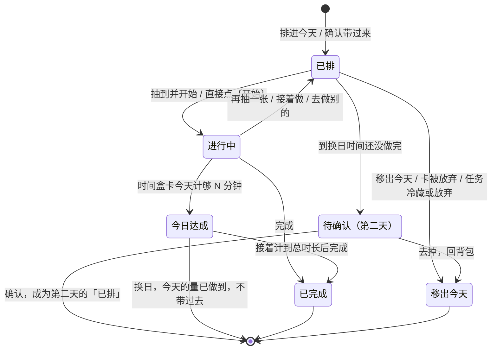
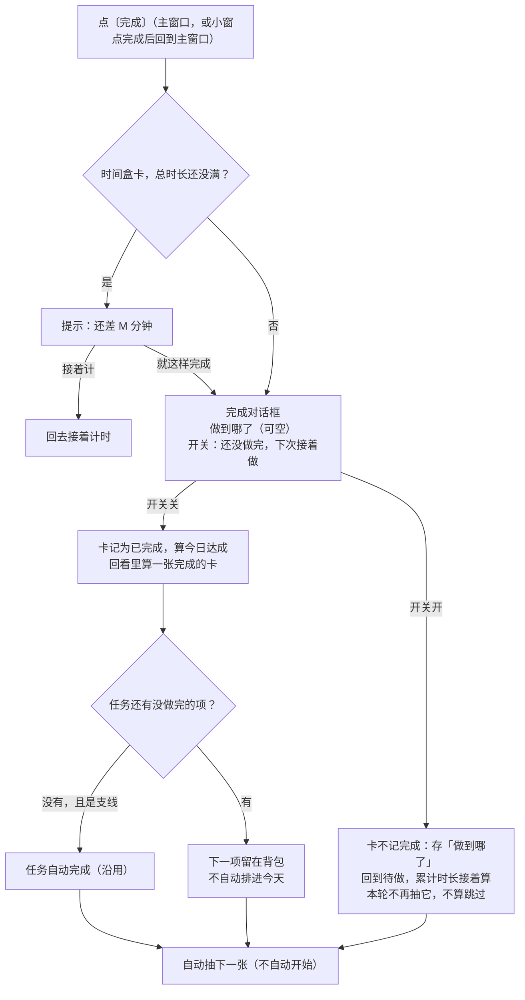
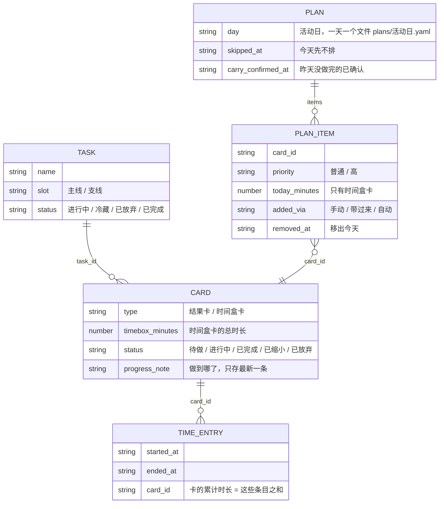
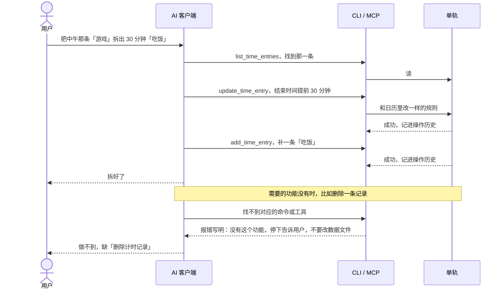
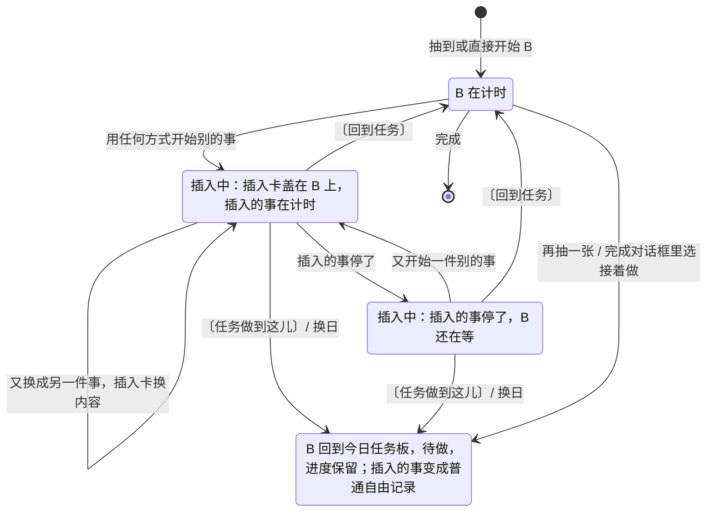

# 0.3.1 流程图（今日任务板、抽卡、完成、数据、agent）

版本 v0.5 · 2026-11-05 · 状态：草案，配合 [0.3.1 计划](0.3.1.md) v0.9 讨论用；数据字段是草案，开工时以 ADR 为准。

依据：计划「已定」与用户 2026-11-05 选的推荐项（0A 1A 2B 3A 4C 5A 6A 7A 8B 9A 10A 11A）。标「提议」的是图里遇到、计划里还没定的情况，待用户确认。

## 1. 一天怎么过

## 2. 抽卡怎么判

点「抽卡」、完成后、选「接着做」后、点「再抽一张」后，都走这一套。

v0.3（计划 v0.6）：去掉阻塞、回顾卡、「自动加进今天」和「快到期先出」；降级休息保留。抽卡只在你不知道做什么时才用，想好了做什么就直接开始。

和现在的区别：去掉阻塞优先、回顾卡、快到期先出和每日底线（每天第一次固定出主线、再出支线的「开场项」）；候选从「背包全部」改成「今日任务板」；随机权重多了优先级。没排进今天的卡不会被加进来，规划时到那天到期的标红。第 2 步「有正在计时或等你回来的卡」里的「等你回来」取决于第 10 节第 2 问。

**候选**是这一次抽卡可以抽到的卡。「本轮跳过」是点「再抽一张」跳过的卡；候选里只剩本轮跳过的卡时，开始新一轮，跳过记录清空，它们重新能抽到。例子：板子上有 A、B、C、D 四项。A 已完成，B 是时间盒卡、今天的 30 分钟计够了，C 刚被「再抽一张」跳过，那候选只剩 D。再跳过 D，候选里只剩本轮跳过的 C、D，于是新一轮，C、D 重新进候选。A、B 今天都不会再出。

**权重例子**：今天排了 4 项。

| 项 | 优先级 | 主线 | 权重 | 抽到的概率 | 主线那项达成以后 |
|---|---|---|---|---|---|
| 读第 4 章 | 高 | 是 | 3 × 1.5 = 4.5 | 45% | — |
| 改简历 | 高 | 否 | 3 | 30% | 54.5% |
| 写小工具 | 普通 | 是 | 1 × 1.5 = 1.5 | 15% | 27.3% |
| 回邮件 | 普通 | 否 | 1 | 10% | 18.2% |

## 3. 一项在今日任务板上的状态

板子上的计数「今日 2/5」= 达成（今日达成 + 已完成）/ 排进的项（不算移出的）。

## 4. 点完成以后

「做到哪了」每张卡仍只存最新一条（现有限制）。缩小出来的子卡现在不显示「还要接着做」；改成同一张卡继续后不再需要新建卡，子卡也可以显示这个开关。

## 5. 数据怎么存（草案）

- 卡、任务、计时条目的格式不变，不加枚举值，退回 0.3.0 / 0.2.5 不会读不了。旧版会忽略 `plans/`，看不到今日任务板。
- 「今日达成」不存，现算：结果卡 = 今天完成了；时间盒卡 = 今天完成了，或今天计到这张卡上的时间 ≥ `today_minutes`。
- 任务模式开关是一个新设置项，默认开；旧的 `settings.yaml` 没有这个键，按默认值读。

## 6. 任务模式关掉以后

| 地方 | 开（默认） | 关 |
|---|---|---|
| 首页 | 抽卡、任务卡、自由计时 | 只有自由计时 |
| 底栏「背包」抽屉 | 今日 / 任务 / 想法 | 只有想法 |
| 每周回顾 | 回看、新想法、擂台、冷库、押注主线 | 去掉押注主线 |
| 快速记录选「待办」 | 进背包 | 照样存进背包，打开开关后能看到 |
| 小窗 | 有卡时有「完成」 | 没有卡，所以没有「完成」 |
| MCP / CLI | 照常 | 照常 |
| 数据 | — | 不删，打开后原样回来 |

## 7. AI 改计时记录（附带需求）

`update_time_entry` 沿用日历的规则：来自卡的条目不能改描述和项目（要在卡上改）；正在计的那条只能改开始时间，不能改成已结束。

## 8. 提议（图里遇到、计划里还没定）

1. 「今天先不排」管到当天结束，或者今天排进第一项为止；之后照常从板子抽。
2. ~~自动加进今天的阻塞 / 快到期卡标「自动」；你把它移出今天后，今天不再自动加回来。~~ v0.2 作废：用户定不自动加入，规划时标红（计划已定第 11 条）。
3. 时间盒卡今天计够 N 分钟时只提醒，不自动停；接着计的时间照样算进总时长。
4. 从抽屉直接点〔开始〕一张没排进今天的卡：可以，但不把它加进今天的板子。
5. 卡被缩小：板子上的这一项换成缩小出来的子卡，子卡做完算今日达成；原卡回到背包的待做，不在板子上。
6. 换日时还在计的那张卡：自动带到今天，不用确认。
7. 带到第二天的项保留优先级；今天的量取「昨天填的」和「剩下的时长」中较小的。
8. 做完一项后，任务的下一项不自动排进今天，抽屉卡片上会出现它的〔排进今天〕。

## 9. 三种「休息」（现状，读代码得出）

| | 降级休息（抽卡图里的「正在休息」） | 快捷活动·插入（如「厕所」） | 自由计时里写「休息」 |
|---|---|---|---|
| 怎么开始 | 30 分钟内「缩小」和「再抽一张」合计 4 次，软件自动进入（设置 02 降级可调） | 你点底栏的快捷活动 | 你在计时框里写 |
| 首页 | 换成休息卡「TAKE A BREAK」，给一条休息池里的建议（休息池默认是空的，就写「去走走或者看看窗外」） | 原来的卡显示「进行中（暂停）」，右上角抽屉有〔回来〕 | 卡回到待做，首页变成「现在做什么？」 |
| 计时记录 | 自动开一条「休息」，项目是系统项目「休息」 | 一条插入记录，不算进卡的时长 | 普通的一条，项目是你选的（默认未分类），软件不把「休息」这个名字当特殊的 |
| 期间能做什么 | 不能抽卡、完成、缩小、再抽一张；MCP / CLI 的计时操作也被拒绝 | 抽卡按钮灰掉 | 什么都能做 |
| 怎么结束 | 只能在界面点〔回来〕：问「刚才实际干了什么」，把那条记录改成你的回答，转成待机，首页回到原来那张卡（待做，要再点开始），不重新抽 | 点〔回来〕，接着计原来那张卡 | 开始别的事就结束 |
| 附带 | 同一个回答出现 3 次，提示「也许它值得正式做，放进支线？」；休息结束后 30 分钟内又拒绝 4 次，不再进休息，改成提示「换成输入吧」 | — | — |

读代码发现的漏洞（未实测）：分开布局下，降级休息时计时条还能开始别的事；从背包直接开始一张卡会跳出休息，不经过〔回来〕，也不记回答。计划已定第 14 条：保留降级休息，修这两个漏洞。

## 10. 插入：做卡时开始别的事（计划已定 19–22）

做卡时，快捷活动、临时活动、计时框或小窗直接输入、收藏、最近的记录，开始的都是「插入」：同一套逻辑，同一张插入卡。没在做卡时照常切换，只有快捷活动和临时活动例外，永远是插入，回来接着原来那条自由记录（计划已定 25）。按钮名：〔回到任务〕= 接着做，〔任务做到这儿〕= 就做到这儿；自由计时时是〔回到原来的事〕〔原来的事不回了〕。

| 正在做 | 快捷活动、临时活动 | 计时框、小窗输入、收藏、最近的记录 |
|---|---|---|
| 一张卡 | 插入 | 插入 |
| 自由记录 | 插入 | 切换 |
| 什么都没在计 | 直接开始 | 直接开始 |

插入中不能抽卡，也不能直接开始另一张卡（计划已定第 20 条），要先选〔回到任务〕或〔任务做到这儿〕。

界面线框：`../UI参考截图/v0.3.1-讨论-03-插入卡.svg`（插入中的首页）、`-04-插入动画分镜.svg`（插入、回到任务、任务做到这儿三段动画）。

例子：B 今天做 60 分钟。做了 30 分钟，同事来消息，在小窗写「回同事消息」，20 分钟后点〔接着做〕，B 再做 30 分钟。B 的累计是 60 分钟，「回同事消息」单独一条，不算进 B。

```mermaid
gantt
  title B 今天做 60 分钟，中间插进来 20 分钟
  dateFormat HH:mm
  axisFormat %H:%M
  section B 读第 4 章
  B 计 30 分钟 :b1, 09:00, 30m
  B 接着计 30 分钟 :b2, 09:50, 30m
  section 插进来的事
  回同事消息 :i1, 09:30, 20m
```

回去的入口：首页插入卡的〔回到任务〕、插入卡上沿露出的任务卡那一条、底栏「↩ 学 408 等你回来」、小窗〔↩〕。待确认 3 条见计划「待用户确认（v0.7）」。

## Revision History

| 版本 | 日期 | 变更 |
|---|---|---|
| v0.1 | 2026-11-05 | 按用户选的推荐项画一天的流程、抽卡判定、板子上一项的状态、完成以后、数据草案、任务模式开关、AI 改计时记录；列 8 条提议待确认 |
| v0.2 | 2026-11-05 | 按计划 v0.5：抽卡图去掉阻塞、回顾卡、自动加入，降级休息和快到期先出标「待定」；加「候选」的解释和例子；状态图去掉自动加入；提议第 2 条作废；加第 9 节三种休息的对照 |
| v0.3 | 2026-11-05 | 按计划 v0.6：抽卡图定稿两处待定（保留降级休息、去掉快到期先出），只标那天到期；加第 10 节「插进来的事，做完回到原来的卡」的状态图和时间例子 |
| v0.4 | 2026-11-05 | 按计划 v0.7：第 10 节改成「插入」，所有入口统一、插入卡取代临时活动抽屉；插入中不能抽卡或直接开始另一张卡；做到这儿后插入的事变成普通自由记录；加线框 03、04 的引用 |
| v0.5 | 2026-11-05 | 按计划 v0.9：第 10 节补快捷活动和临时活动永远是插入，加「正在做 × 入口」对照表 |
