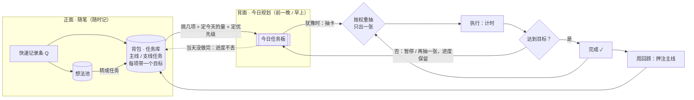
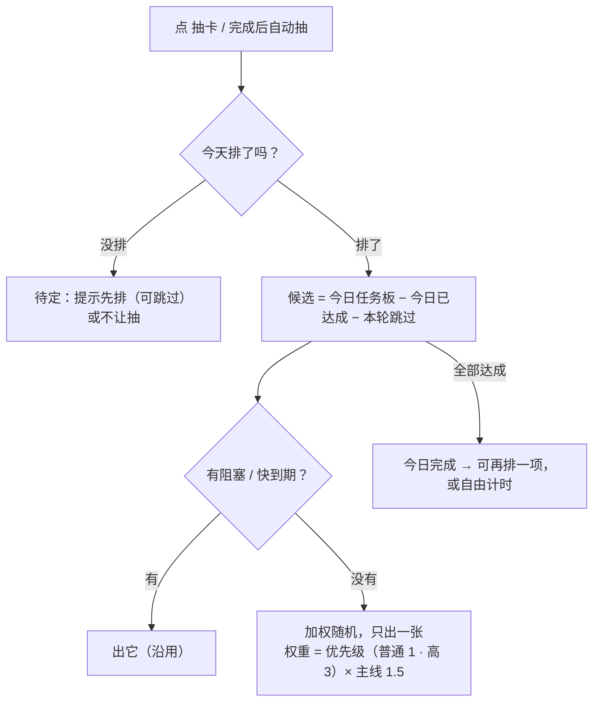

# 0.3.1：任务卡 RPG 化（今日任务板、背包抽屉、任务详情）

版本 v0.1 · 2026-11-05 · 状态：方向讨论中，未开工。用户决定先发 0.3.0 稳定版，再开发本版；开工时再按版本开发流程同步版本号、写执行方案与 ADR。

## Current Plan（v0.1）

用户 2026-11-05 提出：现在的软件只用上了基本计时，任务卡难以落地；想按 RPG 游戏的任务方式重新组织，真正落实最初的设想（治拖延 / ADHD：犹豫时抽一张卡就去做，前提是提前规划）。

版本：用户决定 0.3.0 稳定版先发，本次大改放到 **0.3.1**。注意 `docs/版本开发流程.md` 第 2 节把补丁版定义为「只修 bug，不改数据格式」，本版会新增数据（今日任务板）并重做首页用法；按用户决定用 0.3.1，开工时在流程文档里补一句说明（或届时改用 0.4.0，由用户定）。

### 一张纸的两面（用户的比喻）

- 正面：随笔，想到要做的事就写上去 → 软件里是快速记录条、想法池、背包里的任务。
- 背面：今天的规划，前一晚或早上挑几件、定好时间 → **今日任务板（新增）**。
- 第二天随机从规划里抽一件开始做 → 抽卡只从今日任务板里抽。

### 已定（2026-11-05）

1. **今日任务板**：从背包挑几项排进今天；抽卡只从今日任务板里抽（阻塞、快到期仍优先，沿用）。
2. **不要「开场固定项」**，改成调高抽卡概率：排进今天时给每项选优先级，按权重随机。权重暂定「普通 1 / 高 3」，主线再 ×1.5（沿用现有 `MAIN_CARD_WEIGHT`）。档位与数值待确认。
3. **背包搬进首页**，做成从底栏往上拉的抽屉（有抽屉动画，主观上仍在首页、仍在计时，思维不切换）；在首页直接点开。顶栏去掉「背包」。
4. **抽屉里的任务卡沿用现在背包的卡牌样式，信息量少一点**：一行进度条（一项一段：做完涂黑，时间盒按已计 / 目标涂强调色）、「做完几项 · 计时 累计 / 目标之和」、「下一项」、〔排进今天〕〔开始〕〔详情 ›〕。每项的小字、「计时记到」下拉、操作菜单挪进详情。
5. **任务详情**：在抽屉里点进去（‹ 返回背包），不换页面。列出全部子任务，包括已完成的（灰显并留在卡里）；每项有状态、进度条、类型与目标、〔排进今天〕/「今天已排」、〔开始〕，点一项编辑；底部添加子任务、计时记到、冷藏、放弃。
6. 进度按任务单独保留（卡的累计时长 = 这张卡所有计时条目之和，现有机制）。

线框：`../UI参考截图/v0.3.1-讨论-01-首页背包抽屉.svg`、`../UI参考截图/v0.3.1-讨论-02-抽屉任务卡与任务详情.svg`。

### 抽卡规则（v1，去掉开场项）

工程上改纯函数 `src/domain/picker/pick.ts` 的候选池与权重，可单测。今日任务板单独存（如 `plans/<活动日>.yaml`），v0.2.5 / 0.3.0 是否忽略未知目录，开工前核对。

### 待用户确认

1. 优先级档位：「普通 1 / 高 3」可以吗？要不要「低」？
2. 今天的量：排进今天时「今天做 1 小时」是否和卡本身的总目标分开？
3. 今天没排时：提示先排（可跳过），还是不让抽？
4. 当天没做完的：第二天自动排回今天，还是回背包等重新挑？
5. 「还要接着做」改成同一张卡继续、进度不断（现在会新建一张卡、从 0 算）？
6. 任务模式开关（用户原话「任务卡功能可以设为需要单独启用」）：关掉后保留哪些（计时、日历、列表、回看、想法池）？
7. 想法池、冷藏的任务在抽屉里放哪一页。

## Revision History

| 版本 | 日期 | 变更 |
|---|---|---|
| v0.1 | 2026-11-05 | 记录用户提出的任务卡 RPG 化方向与已定 6 条（今日任务板、按权重抽卡不要开场项、背包首页抽屉、抽屉任务卡精简、任务详情、进度单独保留）；用户决定先发 0.3.0 稳定版、本版定为 0.3.1；待确认 7 条；未开工 |
