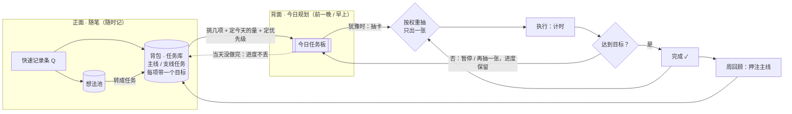
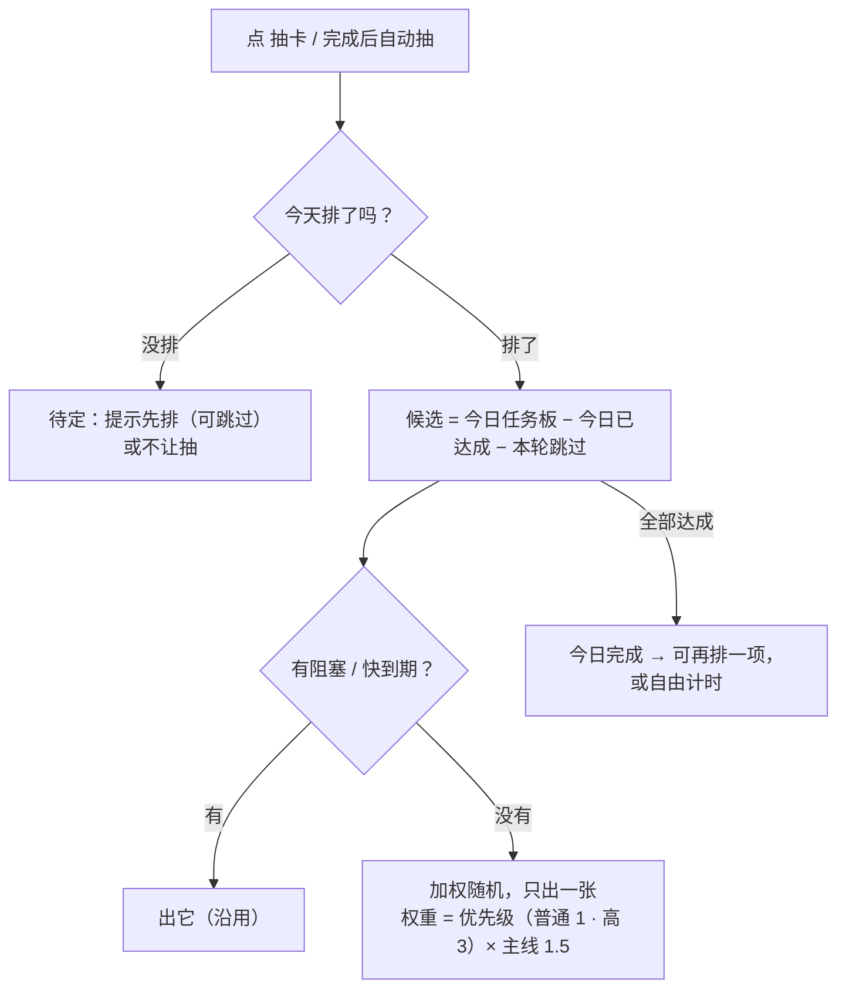

# 0.3.1：任务卡 RPG 化（今日任务板、背包抽屉、任务详情）

版本 v0.38 · 2026-11-06 · 状态：**0.3.1 正式版已发布**，标签 `v0.3.1` 指向 `9db62a7`，签名 CI 与公开资产、生产验签、更新渠道复验通过。用户授权见已定 70；验收范围和未测边界见 `evidence/0.3.1-summary.md`，发布记录见 `evidence/release-0.3.1/summary.md`。

## Current Plan（v0.38）

**开发与验收清单**

- [x] D0：同步版本为 `0.3.1-beta.1`（`npm run version:check` 通过；`npm run check` 通过，619 应用 + 12 MCP + 8 CLI，日志 `evidence/0.3.1-d0-check.log`）。本地提交，未推送。
- [x] v0.5 待确认 5 条（已定 14–18）。
- [x] 「插进来的事」待确认 4 条（已定 19–22）。
- [x] v0.7 待确认 3 条（已定 23、24；第 2 条在 v0.8 重问）。
- [x] 插入卡原型由用户调好并确认（已定 45、47）。
- [x] v0.8 待确认第 1 条（已定 25）。
- [x] 流程图提议 8 条由用户确认（已定 49、53）。
- [x] 原型与截图（背包抽屉、今日任务板、任务详情、排进今天浮层、新建任务、翻卡、缩小），用户确认；已同步 `../UI风格规范.md` §11.14 / §11.15（完成对话框「接着做」、设置开关没做原型，按现有对话框和设置页样式，执行方案 G5 / G6）。
- [x] 执行方案 v1.0 与 ADR 0021 已写。
- [x] 第 1 轮审核（`evidence/0.3.1-plan-review-round1.md`：3 阻塞 / 9 应改 / 7 建议）意见全部处理，方案 v1.1、ADR 0021 修订 2。
- [x] 用户定插入的事暂停 / 继续、宽松 / 紧凑模式进 0.3.1（已定 56–59）。
- [x] 第 2 轮复核（`evidence/0.3.1-plan-review-round2.md`：3 阻塞 / 6 应改 / 6 建议）意见全部处理，方案 v1.2、ADR 0021 修订 3。
- [x] 第 3 轮复核（`evidence/0.3.1-plan-review-round3.md`：1 阻塞 / 5 应改 / 5 建议）意见全部处理，方案 v1.3、ADR 0021 修订 4（Accepted）；审核通过。
- [x] G1–G8：实现、分段审核及 G7 累计读数复核完成（见执行方案与 `evidence/0.3.1-code-review-g7-tail-final.md`）。
- [x] G9 本轮收尾与正式发布：737 应用 + 45 Rust + MCP 12 + CLI 8 + 发版工具 10 项通过；旧版有限原生往返、跨日启动与隔离 UI 回归通过；已推 master / v0.3.1，CI 42193664969 成功，公开资产/生产签名/真实渠道复验通过。完整验收清单中未实测的项目仍逐项保留在汇总中，发布不代替这些验收。

**以下为需求讨论记录。**

用户 2026-11-05 提出：现在的软件只用上了基本计时，任务卡难以落地；想按 RPG 游戏的任务方式重新组织，真正落实最初的设想（治拖延 / ADHD：犹豫时抽一张卡就去做，前提是提前规划）。

版本：用户决定 0.3.0 稳定版先发，本次大改放到 **0.3.1**。注意 `docs/版本开发流程.md` 第 2 节把补丁版定义为「只修 bug，不改数据格式」，本版会新增数据（今日任务板）并重做首页用法；按用户决定用 0.3.1，按小版本的要求做完整收尾（v0.4 已在流程文档第 2 节补了说明）。

### 一张纸的两面（用户的比喻）

- 正面：随笔，想到要做的事就写上去 → 软件里是快速记录条、想法池、背包里的任务。
- 背面：今天的规划，前一晚或早上挑几件、定好时间 → **今日任务板（新增）**。
- 第二天随机从规划里抽一件开始做 → 抽卡只从今日任务板里抽。

### 已定（2026-11-05）

1. **今日任务板**：从背包挑几项排进今天；抽卡只从今日任务板里抽（阻塞、快到期仍优先，沿用）。
2. **不要「开场固定项」**，改成调高抽卡概率：排进今天时给每项选优先级，按权重随机。权重暂定「普通 1 / 高 3」，主线再 ×1.5（沿用现有 `MAIN_CARD_WEIGHT`）。档位与数值待确认（v0.4 已定：普通 1 / 高 3）。
3. **背包搬进首页**，做成从底栏往上拉的抽屉（有抽屉动画，主观上仍在首页、仍在计时，思维不切换）；在首页直接点开。顶栏去掉「背包」。
4. **抽屉里的任务卡沿用现在背包的卡牌样式，信息量少一点**：一行进度条（一项一段：做完涂黑，时间盒按已计 / 目标涂强调色）、「做完几项 · 计时 累计 / 目标之和」、「下一项」、〔排进今天〕〔开始〕〔详情 ›〕。每项的小字、「计时记到」下拉、操作菜单挪进详情。
5. **任务详情**：在抽屉里点进去（‹ 返回背包），不换页面。列出全部子任务，包括已完成的（灰显并留在卡里）；每项有状态、进度条、类型与目标、〔排进今天〕/「今天已排」、〔开始〕，点一项编辑；底部添加子任务、计时记到、冷藏、放弃。
6. 进度按任务单独保留（卡的累计时长 = 这张卡所有计时条目之和，现有机制）。

线框：`../UI参考截图/v0.3.1-讨论-01-首页背包抽屉.svg`、`../UI参考截图/v0.3.1-讨论-02-抽屉任务卡与任务详情.svg`。

### 抽卡规则（v1，去掉开场项）

v0.4 起以 [0.3.1-flows.md](0.3.1-flows.md) 第 2 节为准；下图是 v0.1 的讨论稿，保留作记录。

工程上改纯函数 `src/domain/picker/pick.ts` 的候选池与权重，可单测。今日任务板单独存（如 `plans/<活动日>.yaml`），v0.2.5 / 0.3.0 是否忽略未知目录，开工前核对。

### 代码现状核对（v0.3，2026-11-05）

- 「开场固定项」就是 `pick.ts` 里的每日底线 `baseline()`：今天还没完成过主线卡时，固定出 `order` 最小的主线卡；还没完成过支线卡时，固定出 `order` 最小的支线卡。排在阻塞、回顾、快到期之后，加权随机之前。按已定第 2 条去掉。
- 抽卡顺序现在是：阻塞 → 每周回顾卡 → 快到期（`dueSoonHours`，默认 24 小时）→ 每日底线 → 加权随机（主线 1.5，`MAIN_CARD_WEIGHT` 是写死的常量）。候选是背包里任务的待做 / 进行中的卡，加上不属于任务的卡。完成后自动再抽一张（不自动开始）。
- 卡没有优先级字段。卡的类型只有「结果卡」（没有时间目标）和「时间盒卡」（`timebox_minutes`）。卡的累计时长不存，按计时条目的 `card_id` 现算。
- 「还要接着做」现在是：这张卡记为已完成，另建一张同内容的新卡放到队尾，新卡从 0 计时，两张卡只靠 `continued_from` 关联。「做到哪了」每张卡只存最新一条（`progress_note` 覆盖）。
- 没有任何功能开关；设置都是普通值。新加设置项要给默认值，旧的 `settings.yaml` 没有这个键。
- 新目录 `plans/`：v0.2.5 和 0.3.0 平时只列 `records/ cards/ tasks/ reviews/ timelog/ history/ .journal/`，不扫数据根目录，会忽略它；更新前备份会把它一起备份。新加枚举值（卡状态、任务状态）会让旧版读不了，要避免。
- 背包现在只有 01 任务池（主线 / 支线 / 冷藏）和 02 想法池两页；放弃的任务不显示。

### 已定（v0.4，用户 2026-11-05「按你推荐的来」）

v0.3 列的待确认 0–10 和附带需求的第 1 条，用户都选了推荐项。流程图见 [0.3.1-flows.md](0.3.1-flows.md)。

0. **版本**：先发 `0.3.1-beta.1` 到 Beta 渠道，测好再发 `0.3.1`。已同步版本（D0）。
1. **优先级**：普通 1 / 高 3，不加「低」；主线再 ×1.5。
2. **今天的量**：时间盒卡排进今天时可以填「今天做 N 分钟」，默认是剩下的时长；今天计够了就不再抽它，卡的总进度照常累计。结果卡不填，做完算达成。
3. **今天没排就点抽卡**：提示先去排，也可以选「今天先不排」；选了就从整个背包抽。
4. **今天没做完的**：第二天排今天时，昨天没做完的已经勾好，用户确认或去掉。
5. **还要接着做**：改成同一张卡接着做：不记完成，存下「做到哪了」，卡回到待做，累计时长接着算。回看里「完成的卡」只算真正做完的。
6. **任务模式开关**：关掉后隐藏抽卡、今日任务板、背包里的任务和回顾里的押注主线；计时、日历、列表、回看、想法池、快速记录照常，数据不删。默认开。
7. **抽屉分页**：〔任务 | 想法池〕两页（加上今日任务板），冷藏放在任务页最下面，和现在一样。
8. **前一晚规划**：今日任务板可以在〔今天 | 明天〕之间切换，前一晚直接排明天。
9. **〔排进今天〕的单位**：任务卡上的按钮只排「下一项」这一张卡；要多排几项，到详情里逐项排。
10. **没排进今天的阻塞 / 快到期卡**：自动加进今天的板子，照样优先抽。（v0.5 作废，改为已定第 11 条：不自动加入，规划时标红。）

附带需求第 1 条：**加 `update_time_entry`**（CLI / MCP 修改已有计时记录：开始、结束、描述、项目、标签，规则同日历，记操作历史）；不加删除。

### 已定（v0.5，用户 2026-11-05 看抽卡图后）

用户原话：「自动加进今天的卡……这个机制不能静默加入，只在安排当天事件的时候标红为当日过期」「我打算要删除阻塞机制」「回顾卡机制也不需要」。以下三条取代上面已定第 1 条里的「阻塞、快到期仍优先，沿用」和 v0.4 已定第 10 条。

11. **不自动加进今天**：没排进今天的卡不会被悄悄加进板子。规划时（排今天或明天、看背包任务和详情），到那天到期或已经过期的卡标红提醒，排不排由用户决定。
12. **删除阻塞机制**：快速记录条的〔阻塞〕、编辑事项的「阻塞」开关、背包里的 BLOCK 标记、CLI `todo add --blocking` 都去掉，抽卡不再看阻塞。为了退回 0.3.0 / 0.2.5，记录和卡的文件里仍写 `blocking: false`（旧版要求有这个字段）；旧的 MCP / CLI 调用带着 `blocking` 不报错，只是不起作用。
13. **抽卡不再出回顾卡**：首页不再出「每周回顾」卡和卡角的「开始回顾」；每周回顾从顶栏「回顾」进去，和现在一样。

### 已定（v0.6，用户 2026-11-05 回答 v0.5 的 5 条：「1.保留 2.B 3.B 4.A 5.B」）

14. **降级休息保留**，顺手修两个漏洞：分开布局下休息时计时条还能开始别的事；从背包直接开始一张卡会跳出休息、不经过〔回来〕。
15. **板子上快到期的卡不再固定先出**，只按权重随机；到期提醒只靠规划时标红。
16. **只标那天到期的卡**（已经过期的不标红）。
17. **旧卡上已有的阻塞标记不改文件**，0.3.1 里直接忽略；退回 0.3.0 时那几张又会排最前，用户接受。
18. **回顾卡去掉后不加提醒**，每周回顾和主线押注到期都要用户自己去顶栏「回顾」看。

### 新需求：插进来的事，做完回到原来的卡（v0.6，讨论中）

用户原话（2026-11-05，节选）：「今天我要做 ABC，做到 B 的途中，有一些别的事情插进来，我必须去处理。这个时候我会切到自由计时模式，把这件事记下来。记完之后，我要回到任务模式，回到原本的计划。这样的情况会出现很多。」「规划一般有很大的冗余，可能只会占一天 60% 的时间，额外增加的事情可能会占 40%。」「我在小窗口那里直接输入我要做什么，那我就直接切换到自由计时模式，那我换回去怎么办？」「抽卡只是一种选择……你决定了某些时候做什么事，你就可以直接做；除非你不知道做什么，才会抽卡。」「我换了东西之后，自动暂停……我可以选择返回。如果我要做 1 个小时，中间插了 20 分钟做别的事情，我希望后面做完那件事之后，接着前面那半小时往后做。」「在背包的抽屉里面是一个返回状态，你可以取消，直接当做这个事情就做到这儿，或者说是接着做。」

**现状**（读代码）：
- 底栏快捷活动选「插入」的（如厕所）和 0.2.5 的临时活动已经是这样：卡停在「进行中（暂停）」，首页右上角抽屉有〔回来〕，回来接着计这张卡，插进来的时间不算进卡（`insertInTx`、`resume_entry_id`）。
- 在主窗口计时框、小窗里直接输入，点收藏（默认「切换」）或「最近的记录」，走的是「切换」（`startFreeInTx`）：卡被放回待做，首页变成「现在做什么？」，没有回来的入口。要回去只能从背包或自动完成里重新开始这张卡。卡的累计时长不会丢（按计时条目现算）。

**提议的机制**（流程图见 [0.3.1-flows.md](0.3.1-flows.md) 第 10 节；v0.7 起以已定 19–22 为准：第 3 条的显示位置改成首页插入卡、上沿露出的任务卡和底栏，第 6 条的「直接开始另一张卡」改成不允许）：
1. 做卡途中，从任何入口开始别的事（计时框、小窗、收藏、最近的记录、快捷活动），卡都不放回待做，而是「等你回来」：卡暂停，插进来的事单独一条记录，不算进卡的时长。
2. 插进来的事可以接着换成别的事，也可以停掉，卡一直等着。
3. 「等你回来」显示在：背包抽屉顶部一栏（卡名、已做 / 今天的量、〔接着做〕〔就做到这儿〕）、首页那张卡（显示暂停中）、小窗〔↩ 回到 B〕。
4. 〔接着做〕：插进来的事结束，卡接着计，累计时长从上次停的地方往后加。
5. 〔就做到这儿〕：卡不再等，回到今日任务板，待做，进度保留，之后还能抽到或直接开始。
6. 直接开始另一张卡：原来等着的卡自动「就做到这儿」（同一时间只等一张）。换日时还在等的卡也自动「就做到这儿」，按已定第 4 条第二天确认带不带。

**待用户确认（v0.6）**：
1. 〔就做到这儿〕的意思：先停在这（回到板子上待做，可以写一句做到哪了），还是算这张卡完成？
2. 卡在等你回来时，能不能抽卡：不能（先选〔接着做〕或〔就做到这儿〕），还是能（抽到新卡时原来那张自动就做到这儿）？
3. 只对卡这样，还是自由计时之间也一样（自由计时「写报告」时插进来别的事，也能回到写报告）？
4. 0.2.5 的首页右上角临时活动抽屉：留着显示正在做的插进来的事和〔回来〕，和背包抽屉顶部那一栏同时有；还是只留背包抽屉那一栏？

### 已定（v0.7，用户 2026-11-05 回答 v0.6 的 4 条）

用户原话（节选）：「比如我今天要做 1 小时某个事，做了半小时后暂停，相当于放回背包……剩余半小时」「2.A 3.A」「快捷活动……我们现在讨论的是，我做某个任务卡要做的事情，也是插入进来，只不过这个插入进来不一定是快捷活动。本质上都是插入，所以我想把它们的 UI 统一。它应该是整个首页的覆盖，就像一张卡覆盖在任务卡上……在取消的时候，我就可以还原到正常的自由记录形式；没有取消的时候，就是插入形式……任何事件、快捷活动和插入活动的逻辑是相同的。」

19. **〔就做到这儿〕= 先停在这**：卡放回背包，仍在今日任务板上，待做，进度保留。今天的量按已做的扣：今天 60 分钟做了 30，板子上显示 30 / 60，还剩 30。之后再开始，卡的时间接着累计，不从 0 算；日历里是新的一段记录。
20. **卡在等你回来时不能抽卡**，先选〔接着做〕或〔就做到这儿〕。
21. **只对卡这样**；没在做卡时，开始别的事照常切换。（v0.9 补例外：快捷活动和临时活动永远是插入，见已定第 25 条。）
22. **插入统一**：做卡时，快捷活动、临时活动、计时框或小窗直接输入、收藏、最近的记录，开始的都是「插入」，同一套逻辑、同一个界面。界面是一张盖在任务卡上的「插入卡」，覆盖整个首页，取代 0.2.5 首页右上角的临时活动抽屉（ADR 0006 要改）。插入卡上有〔回到任务〕〔任务做到这儿〕；选了做到这儿，插入卡还原成普通的自由记录卡，插入的事接着计。插入卡的样子和动画由开发方设计，线框 `../UI参考截图/v0.3.1-讨论-03-插入卡.svg`、`-04-插入动画分镜.svg` 待用户确认。

### 已定（v0.8，用户 2026-11-05：「1.A … 3.你画的这个动画分镜要在原型里继续调试」）

23. **卡上的大读数显示今天在这张卡上做了多久**，和「今天 60 分钟」对得上；这张卡的总累计写在标题下面的小字里。
24. **插入卡按叠卡做**（线框 03、04 的分镜），在 HTML 原型里继续调：`../原型/页面/insert-prototype.html`（类名 `ins-` 前缀，左边「演示控制」能触发各种情况、调缩放 / 露出高度 / 浓淡 / 各段时长和缓动、切动效等级和窗口大小、复制参数），截图 `../UI参考截图/v0.3.1-插入原型-01..06-*.png`。原型里 `?selftest` 按「完整」动效走一遍插入、换内容、回到任务、做到这儿、自由计时时切换，2026-11-05 无头 Edge 跑过，结果 OK。真窗口和正式代码都还没做。

### 已定（v0.9，用户 2026-11-05 回答 v0.8 第 1 条：「A」）

25. **快捷活动和临时活动永远是插入**：做卡时、自由计时时都盖插入卡，回来接着原来那件事（自由计时时插入卡的按钮是〔回到原来的事〕〔原来的事不回了〕）。设置 05 里快捷活动、收藏每一项的「切换 / 插入」去掉：快捷活动一律插入，收藏一律按第 21、22 条（做卡时插入，自由计时时切换）。计时框、小窗、最近的记录同收藏。原型已按这条改，去掉了「待定」开关。

### 已定（v0.10，用户 2026-11-05）

用户原话：「这个任务做到这，是指被插入任务，应该改成结束原任务，点击会提醒是否要结束"xxx"，然后灰字备注 若未完成则重新放入背包。」

26. **〔任务做到这儿〕改名〔结束原任务〕**（英文小字 END），点了先弹确认：标题「结束「学 408：读第 4 章」？」，下面灰字「若未完成，则重新放入背包。」，按钮〔取消〕〔结束〕；Esc 和点遮罩等于取消。结束后的效果不变（同已定第 19 条：卡放回背包，仍在今日任务板上，进度保留；插入卡变成普通自由记录卡）。自由计时时同样改成〔结束原来的事〕，确认框写「结束「写周报」？」和「这条自由记录到此为止，插入的事接着计。」。原型已改，截图 `v0.3.1-插入原型-07-结束原任务确认.png`，02、03、06 重拍，04 改名为「结束原任务以后」。本计划前面写的〔任务做到这儿〕〔就做到这儿〕，都按这条读作〔结束原任务〕。

### 已定（v0.11，用户 2026-11-05）

用户原话：「这样我们 UI 设计稍微有活力一点：下面的『回到原来』这个按钮，你看它现在是从上往下的抽屉嘛，你就把它换成一个很大块、整个长度的、向上的渐变箭头区域，里面有个箭头……就是一个很大的平面设计，你往上走的话，上面就是一个大口子。」

27. **〔回到任务〕改成插入卡边上整条宽的回去区域**：横跨整张插入卡，强调色向上（或向下）渐变到透明，里面一个大的实心向上箭头，旁边「回到任务 / BACK TO QUEST」和「学 408：读第 4 章 · 25:00 / 60:00」，点整块回去。按钮那一排不再有〔回到任务〕，只剩〔结束原任务〕〔暂停〕〔停止〕。动效「完整」时箭头上下浮动；鼠标放上去，插入卡先往上抬一点（默认 14px），像要被推回上面。原型里两种位置都做了：底边（默认，像抽屉的把手，往上推回去）和顶边（箭头指着上面露出的任务），左边「回去区域」可切换，也能调高度和抬起多少；截图 02、03、06、07 重拍（底边），08 是顶边。上沿露出的任务那一条、底栏「↩ 等你回来」照样能点回去。

### 已定（v0.12，用户 2026-11-05）

用户原话：「它这个太显眼了。比如我在做插入任务时，你可以用你的强调色显示。这个强调色不显示文字，等鼠标移上去才会显示文字。不然你看一眼当前时间，一看就是 4 个大字『回到任务』，比较扰乱心神。然后这个强调色渐变稍微不均匀一点。」

28. **回去区域平时只有颜色，不出字**：鼠标放上去（或键盘移到上面）才出「回到任务 / BACK TO QUEST」和「学 408：读第 4 章 · 25:00 / 60:00」，字从箭头右边展开，颜色同时变浓；离开就收起。平时默认带一个很淡的箭头（不透明度 30%），原型里可以换成「只有颜色」。渐变改成几团深浅不一的光叠在一起（左边最浓、中间最淡、右边次之），边上一定淡到没有、不留硬边；动效「完整」时这几团光 14 秒一个来回慢慢左右飘，可关。箭头只在鼠标放上去时跳，平时不动。区域默认高 76px。截图 02、03、06、07、08 重拍，09 是鼠标放上去的样子。

### 已定（v0.13，用户 2026-11-05：「渐变色颜色改为黑灰色呢？感觉现在这个也太绿了」）

29. **回去区域的渐变改成黑灰**（墨色 `--ink`，几团光的浓淡同第 28 条：左边最浓、中间最淡、右边次之）。平时的淡箭头是白色；鼠标放上去渐变变成接近黑底，字是白的，箭头换成强调色（强调色只放在黑底上，合 UI 风格规范）。原型左边「回去区域 → 颜色」可以切回强调色对比。截图 02、03、06、07、08、09 重拍。

### 已定（v0.14，用户 2026-11-05：「常驻状态下的颜色改淡一点点，然后你改成黄色的强调色试试」）

30. **回去区域平时的颜色再淡一点**：黑灰几团光的浓度 70/26/52/14% → 58/20/44/11%，强调色版 94/46/80/24% → 82/38/68/20%；鼠标放上去的浓度不变。

原型加了「强调色（同设置 06 外观）」一栏，四个选项和正式软件一样（信号黄 / 薄荷绿 / 天青 / 警示橙），按用户说的先切到信号黄。截图 02、03、06–09 是薄荷绿（平时已按第 30 条变淡），10–13 是信号黄的对比：黑灰渐变平时 / 鼠标放上去、黄色渐变平时 / 鼠标放上去。

### 已定（v0.15，用户 2026-11-05）

用户原话：「把这个"结束原任务"放在渐变处的右边，用一个比较融协调的方式，你想办法融入那上面。类似于：鼠标移上去是"回到任务"，鼠标再移到右边的位置，会显示"是否结束当前任务"。这样子也是一个平面设计吧，你想想怎么办。」

31. **〔结束原任务〕并进回去区域的右边**：同一条渐变用一道斜切（斜边宽 26px）分成两块，左边大块 =〔回到任务〕，右边一块 =〔结束原任务〕。按钮那一排只剩〔暂停〕/〔继续〕和〔停止〕（取代第 27 条里「只剩〔结束原任务〕〔暂停〕〔停止〕」）。
    - 平时：看着还是一整条，没有字。左边一个淡的向上箭头（回到任务），右边一个淡的向下箭头（同一个箭头倒过来，往下 = 放回背包）。右边那块平时窄，宽 `clamp(180px, 20%, 260px)`。
    - 鼠标在左边：整条变暗（左边全浓，右边 82%），斜切线淡淡出现。左边出字，同第 28、29 条；右边只露一行淡字「结束原任务」和淡的向下箭头。插入卡往上抬，同第 27 条。
    - 鼠标移到右边：右边往左展开到 `clamp(380px, 46%, 580px)`，斜切跟着滑过去，底色加实，左边退到 45%。右边出「是否结束「学 408：读第 4 章」？」，下面灰字「若未完成，则重新放入背包」。斜切线和向下箭头变成提醒色（黑灰版用 `--over`，强调色版用 `--red`）。插入卡不抬。
    - 点右边：默认点一下就结束，因为鼠标放上去时已经问过了。第 26 条的确认框改成可选：原型「回去区域」一栏可以换成「再点一下」（第一次点后问句变成「再点一下，结束」，3 秒内或鼠标离开前再点才结束），或「弹确认框」（同第 26 条）。结束后的效果不变，同第 19、26 条。
    - 自由计时时：右边淡字是「结束原来的事」，灰字「这条自由记录到此为止」。
    - 放顶边时一样，斜切方向反过来，字贴着顶边。原型把渐变和遮罩挪到了底层，字不再跟着渐变一起淡掉（顶边时灰字原来看不清）。

截图：02、03、06–09 重拍（薄荷绿），10–13 重拍（信号黄）。新增 14「鼠标放在结束区域上」、15「结束区域-顶边」、16「结束区域-960x600」、17「信号黄-黄色渐变-鼠标放在结束区域」（都是信号黄）。07 的确认框现在只在「弹确认框」时出现。

原型自测（`?selftest`）通过，覆盖：平时右边没有字；三种点法（弹确认框的打开和取消、再点一下、结束）；自由计时时右边的字。截图里的「鼠标放上去」是用 `&hover` / `&hover=end` 加的样式，不是真鼠标。**未测**：真鼠标移动时展开 / 收起的动画和左右来回移动的手感、键盘 Tab 到右边那块、「再点一下」状态的样子（没截图）。

### 已定（v0.16，用户 2026-11-05）

用户原话：「1和前面说的一样，显示弹窗是否结束 2不用，为啥要加这个，结束原任务和停止按钮不就是两个任务的结束吗，再加做完了是何意味 3设置可选 4不用 5你加一个灰白试试 6先等下 7这个在调」

32. **点右边那块弹确认框**：同第 26 条，标题「结束「xxx」？」、灰字、〔取消〕〔结束〕。取代第 31 条里「默认点一下就结束」和两种可选点法，原型去掉「点一下就结束 / 再点一下」。鼠标放上去时右边照旧出「是否结束「xxx」？」作提示。
33. **不加〔做完了〕**：〔结束原任务〕结束的是原任务，〔停止〕结束的是插入的事，已经够了（v0.10 待确认第 0 条作废）。
34. **回去区域放底边还是顶边做成设置项**，用户自选。默认值和放在设置哪一页留到写执行方案时定（原型默认底边）。
35. **默认强调色不改**，仍是薄荷绿；信号黄只是原型里试过。原型默认强调色改回薄荷绿。
36. **回去区域颜色加「灰白」试看**：和黑灰、强调色并列，原型「回去区域 → 颜色」三选一。灰白版平时是浅灰的光（`#b4b4ae`），鼠标放上去变浅灰底（`#c4c4be`）、墨色字、墨色箭头，斜切线和向下箭头用 `--red`。还没定用哪种。
37. 流程图第 8 节 7 条提议：用户说先等。原型参数：用户在调。

截图：07「结束原任务确认」、14「鼠标放在结束区域上」按薄荷绿重拍；新增 18「灰白-平时」、19「灰白-鼠标放上去」、20「灰白-鼠标放在结束区域」、21「灰白-顶边-结束区域」。10–13、15–17 是 v0.15 的信号黄截图，没有重拍，其中 15–17 拍的时候点法还是「点一下就结束」，样子没变。原型自测（`?selftest`）通过，覆盖右边点了弹框、取消、结束。**未测**：真鼠标手感、键盘 Tab。

### 已定（v0.17，用户 2026-11-05）

用户原话：「你那根斜线不要把它去掉。比如你把鼠标移上去之后，在右边用渐变的方式（就像你现在渐变的方式），是红色的"烟雾状"，然后你那个箭头去掉，只显示"结束原任务"」（理解为：斜线不要，去掉。）

38. **右边那块改成红色烟雾**：去掉斜切线和向下箭头，左右两块不再斜切重叠。鼠标放上去，右边从卡片边升起一团红色烟雾（`--red`，几团深浅不一的光叠成，同回去区域的做法，往卡里和往左都淡到没有，动效「完整」时慢慢飘），上面只写白字「结束原任务」（自由计时时「结束原来的事」），不再显示「是否结束「xxx」？」和灰字。点了照旧弹确认框（第 32 条）。黑灰、灰白、强调色三种颜色下，烟雾都是红色。

截图：14、20、21 重拍；新增 22「红烟雾-黑灰」、23「红烟雾-灰白」、24「红烟雾-灰白-顶边」、25「红烟雾-960x600」。15–17 是旧样子（斜线和问句），没重拍。原型自测（`?selftest`）通过，新增检查：右边没有斜线、箭头和问句。**未测**：真鼠标手感。

### 已定（v0.18，用户 2026-11-05）

用户指出：鼠标在右边时，左右两块交界处有一条竖线；顶边还是旧样子（斜切），要按底边改。

39. **整条只有一层变暗**：原来左右两块各盖一层变暗的渐变，浓淡不同，交界处出一条竖线。现在改成整条回去区域只画一层：鼠标在左边时全浓，在右边时一半浓，红烟雾叠在上面。**顶边同底边**：去掉斜切，也是整条一层加红烟雾，烟雾从顶边往下淡。

截图：14、15、17、20–25 重拍（15、17 现在也是红烟雾）。原型自测通过；放大 2 倍核对过底边、顶边、灰白、黄色强调色四种，交界处都没有线。**未测**：真鼠标手感。

### 已定（v0.19，用户 2026-11-05）

用户原话：「顶上有缝隙，你可以改成：鼠标移上去之后红色自然出现，和原本强调色的渐变一样。移上去之后不会像现在这样自然放大，而是正常显示」

40. **红烟雾和回去区域的渐变同一种画法**：几团深浅不一的光叠成，铺满右边那块，往卡里、往左淡到没有。鼠标放上去只淡入（0.3 秒），不放大、不位移（取代第 38 条里「从卡片边升起」）。动效「完整」时仍慢慢飘。**顶边贴着卡片上沿**，去掉原来的 4px 缝。

截图：08、14、15、17、20–25 重拍，新增 26「信号黄-顶边-结束区域」。原型自测通过；放大 2 倍核对过底边、顶边的黄色强调色和黑灰、灰白，顶上没有缝，交界没有线。**未测**：真鼠标手感。

### 背包抽屉原型（v0.20，用户 2026-11-05「这个抽屉 ui 动效感觉已经没问题了……接下来写一下背包的原型吧」）

插入卡原型的动效用户确认没问题（参数沿用原型默认值）。按已定 3–9、11、15、16 做了背包抽屉原型 `../原型/页面/bag-prototype.html`，截图 `../UI参考截图/v0.3.1-背包原型-01..08`：

- **抽屉**：底栏〔背包 · 今日 1/5〕点开，从底栏往上滑出，占首页 82%；上面露出那张卡的顶边，稍暗一点，照常计时。抽屉顶边：黑块「背包 BACKPACK」+ 正在计的那一项和读数 +〔ESC 收起〕。Esc、点收起、点上面的卡都收起。
- **左边今日任务板**（宽 300px）：〔今天 | 明天〕切换；每行：状态方块、MAIN/SIDE、名字、优先「高」黑底标、今天的进度（时间盒「今天已计 / 今天做 N 分钟」，结果卡「完成条件」），鼠标放上去出〔开始〕〔移出〕；达成的划掉留着。底部〔抽一张 DRAW FROM TODAY〕，说明从几项里抽。明天的板子只能排不能抽。
- **右边〔任务 | 想法池〕**：任务卡同背包卡牌，内容是：进度条（一项一段，做完涂黑，时间盒按比例涂强调色）、「n/m 项 · 计时 累计 / 目标之和」、「下一项」块、〔排进今天〕或「今天已排 ✓」（点了移出）、〔开始〕、〔详情 ›〕；点卡空白处也进详情。冷藏折在任务页最下面。
- **任务详情**：在抽屉里换掉右边（‹ 背包 · 任务，Esc 返回），列全部子任务，做完的灰显留着；每项有状态、类型、记到、标签、到期、进度，〔排进今天〕〔开始〕；底部〔＋ 添加子任务〕、计时记到、冷藏、放弃。
- **排进今天浮层**：优先〔普通 | 高〕，时间盒填「今天做 N 分钟」（默认剩下的时长），那天到期的标红一行；结果卡不填。
- **今天没排点抽卡**：弹「今天还没排」，〔这次先不排〕（从整个背包抽）或〔去排今天〕（拉开抽屉）。
- 抽到时中间翻出一张黑卡「抽到了 · 概率 n%」，然后开始那一项；在抽屉里点〔开始〕后自动收起（原型可关）。

原型里替用户做的决定，待确认（见下）。原型自测（`?selftest`）通过：抽屉从底部拉开、卡片和板子行数、下一项、今天已排、详情含已完成项、排进今天浮层的默认分钟和到期提示、排进明天、抽卡后开始板子上的一项并收起、Esc、今天没排先问。**未测**：真鼠标手感、键盘 Tab 走一遍。

### 已定（v0.21，用户 2026-11-05）

用户原话：「这个卡片 ui 感觉太黑了，导致视觉重点不在文字上，你想想还有什么方案，这个卡的样式可以大胆换掉。然后首页的再抽一张去掉，相当于抽卡直接在今日任务板里抽，然后这个按钮不要全黑。你想想怎么改好看吧。」

41. **首页去掉〔再抽一张〕**：抽卡只在今日任务板底部的〔抽一张〕。做卡时首页按钮是〔完成〕〔缩小〕〔暂停〕；待机时首页的〔抽一张卡〕换成〔今日任务板〕（拉开抽屉）。这一条连带影响已定的降级休息（第 14 条）：降级的计数原来是「缩小」+「再抽一张」，现在首页没有再抽一张，计数怎么算待确认（见下）。
42. **抽屉里的任务卡换样式（待选）**：原型里三种可切换：
    - **纸卡**（原型默认）：白底细框，去掉左边整条黑竖条；主线顶边一道强调色、左上一个强调色小标签「主线」，支线标签灰框；标题 18px 墨色；进度条变细；「下一项」只用左边一道细线。
    - **便签**：没有边框，浅灰底，主线浅强调色底；标签只是一行字，主线下面一道强调色；鼠标放上去略微抬起、歪一点。
    - **黑条**：v0.20 原样，留着对比。
43. **按钮不再全黑**：〔抽一张〕改成浅底细框、底边一道强调色，右边三张叠着的小卡（最上面那张强调色），鼠标放上去散开；〔开始〕改成白底细框加一个小三角；板子上的「高」改成浅强调色底；抽到时翻出的卡改成白卡、顶边强调色。浮层里〔排进今天〕和〔加上〕这种确认按钮仍是黑底。

截图：01–08 按纸卡重拍，新增 09「抽屉拉开-便签」、10「任务详情-便签」、11「抽屉拉开-黑条对比」；第 1 稿收在 `../UI参考截图/v0.3.1-背包原型旧/第1稿/`。原型自测通过，新增检查：首页没有〔再抽一张〕、〔抽一张〕不是黑底、纸卡没有黑竖条。**未测**：真鼠标手感。

### 已定（v0.22，用户 2026-11-05「背包这个块也改一下，太黑了」）

44. **抽屉顶边的「背包」不再是黑块**：墨色字「背包 BACKPACK」，左边一个强调色小方块，这一段底边一道强调色，右边一条细线和正在计的那一项隔开。截图 02–05、07–11 重拍。原型自测加一项：「背包」不是黑底。

### 已定（v0.23，用户 2026-11-05）

用户原话：「ui 样式上背包也没问题了（按当前原型参数），上面的插入 ui 也是。然后背包不知道是不是你没写，是可以添加主线（新加）和支线卡的」

45. **背包抽屉和插入卡的 UI 按当前原型定稿**，参数用两个原型的默认值：
    - 背包：抽屉高 82%，拉开 / 收起 320ms SNAP，今日任务板宽 300px，上面那张卡亮度 .94、缩放 .985，在抽屉里点〔开始〕后自动收起，任务卡用**纸卡**（v0.21 待确认第 1 条定下）。原型 `../原型/页面/bag-prototype.html`。
    - 插入卡：原型 `../原型/页面/insert-prototype.html` 的默认值（回去区域放底边，渐变黑灰，平时带淡箭头，光飘动，鼠标放上去箭头跳）。底边 / 顶边做成设置项（已定 34），默认底边。渐变颜色（v0.16 待确认第 1 条）按默认定为**黑灰**。
46. **任务页可以新建主线和支线任务**（0.3.0 背包已有，v0.20 原型漏了）：主线、支线两区的最后各有一个虚线新建块「设定主线任务 / 再设一个主线任务」「新建支线任务」，到上限就不显示（主线默认 1 个，原型设 2 好演示；支线 10 个）。点了弹新建对话框，同 0.3.0：任务名、下面要做的事（主线最多 5 项，不拆就是任务本身这一件事）、计时项目。0.3.1 每一项多一个〔结果 | 时间盒〕，选时间盒填分钟数（默认 60）。

截图：02 重拍，新增 12「新建主线任务」、13「新建支线任务」。原型自测通过，新增检查：两个新建块都在、没写任务名不能保存、改类型不丢已填的字、支线新建后出现在卡片里、主线到上限后新建块消失。**未测**：真鼠标手感。

### 已定（v0.24，用户 2026-11-05 发回两个原型调好的参数）

47. **两个原型的参数按用户调好的定稿**，写成原型默认值，取代第 45 条里我按默认值替用户定的几项：
    - **背包抽屉**：`{"openMs":280,"openEase":"snap","drawerH":92,"boardW":380,"cardDim":0.91,"cardScale":0.985,"closeOnStart":true,"cardStyle":"便签"}`。即抽屉高 92%，拉开 / 收起 280ms SNAP，今日任务板宽 380px，上面那张卡亮度 .91、缩放 .985，点〔开始〕后自动收起，**任务卡用便签**（不是纸卡）。
    - **插入卡**：`{"scale":0.96,"sink":8,"peek":66,"dim":0.4,"backMs":280,"dropDelay":120,"dropMs":340,"dropEase":"snap","outMs":280,"outEase":"fling","flyMs":520,"flyEase":"snap","growMs":320,"flash":true,"decode":true,"upPlace":"底边","upH":56,"lift":14,"upBob":true,"upIdle":"颜色和淡箭头","upDrift":true,"upTone":"强调色"}`。即任务卡退后缩到 .96、上沿露出 66px、退后 / 回来 280ms，回去区域高 56px，**渐变跟着强调色**（不是黑灰），放底边（设置项默认值）。
    - 用户发回的插入卡参数里还有一项 `freeQuick: "切换"`，是 v0.8 原型「待定」开关留在浏览器里的旧值；v0.9 已定 25 把这个开关去掉了（快捷活动和临时活动永远是插入），原型已经不读它，计划不变。

截图：插入原型新增 27–30「定稿-插入中 / 鼠标在左边 / 鼠标在右边 / 960x600」，背包原型新增 14–17「定稿-抽屉拉开 / 任务详情 / 排进今天浮层 / 960x600」，都是新默认值下拍的；早先的截图保留作过程记录。两个原型自测都通过。

### 已定（v0.25，用户 2026-11-05）

用户原话：「什么翻卡，你做一下试一下？然后降级休息不设置计数了，可以选择主动休息，降级机制保留，和原来一样是自己填降级后的任务。134567 可以，然后 5 卡被缩小的这个做一个原型给我看看……这个在缩小的时候就要填：比如今天要做这个任务的 25%，缩小成 15%，就要填剩下的 10% 放回背包里面，这个是要填的。8 没懂你讲一下」

48. **降级休息不再按次数自动进入**（取代已定 14 里「30 分钟内缩小 + 再抽一张满 4 次自动休息」，v0.21 待确认第 2 条作废）。改成**主动休息**：首页卡头右上角〔休息一下〕，自己决定歇。**缩小（降级）保留**，和原来一样自己填缩小后的内容，见第 50 条。
49. **流程图第 8 节提议 1、3、4、6、7 采纳**：「今天先不排」管到当天结束或排进第一项为止；时间盒今天计够只提醒不自动停；从抽屉直接开始没排进今天的卡可以，但不加进板子；换日时还在计的卡自动带到今天；带到第二天的项保留优先级，今天的量取「昨天填的」和「剩下的时长」中较小的。提议 5 由第 50 条取代；提议 8 待用户听完解释再定。
50. **缩小 = 把这一项拆成两项**（取代提议 5「板子上换成缩小出来的子卡、原卡回背包」）：
    - 今天做的那一份：留在原来的位置、留在今天的板子上、接着计时；已经计的时间算在这一份里。
    - 剩下的那一份：变成同一任务里的新一项，排在今天这份后面，回到背包，不在今天的板子上。任务进度条多一段。
    - 时间盒：对话框里拖条子分「今天做多少分钟」和「剩下多少分钟」，两份加起来等于原来今天的量（例：60 分钟，今天 35，剩下 25）；两份都要写内容（今天做到哪、剩下的是什么）。
    - 结果卡：写「今天做到哪」和「剩下的」两句，两份都是结果卡。
    - 两份都标「SHRINK 1」级数，剩下的那份标「剩下的」，鼠标放上去看到原来是哪一项。缩小的级数上限照旧。
51. **抽卡做成翻卡**（试看）：点〔抽一张〕，板子上没达成的几项（最多 6 张）背面朝上，从〔抽一张〕飞出来摊成一排，洗一下，抽中的那张抬到中间翻面，其他的收走。翻开的卡写主线 / 支线、名字、所属任务、今天的量、这次抽到的概率；下面〔换一张〕〔开始〕。〔换一张〕= 这一轮跳过它重抽，同 v0.4 的候选规则。原型左边可关掉翻卡、调速度。

截图：背包原型 01 重拍（首页没有〔再抽一张〕，多了〔休息一下〕），新增 18–20「翻卡-发牌 / 洗牌 / 翻开」、21「缩小-时间盒」、22「缩小-结果卡」、23「缩小以后的任务详情」。原型自测通过，新增检查：翻卡摊开多张、点〔开始〕后开始那一项；时间盒缩小拆成两项、分钟数加起来不变、今天的量跟着改、剩下的那项不在板子上、继续计今天那份。**未测**：真鼠标手感；翻卡动画的节奏要用户自己看。

### 已定（v0.26，用户 2026-11-05「翻卡可以，我觉得没问题，你的概率不用显示出来」）

52. **翻卡定稿**（第 51 条），节奏用原型默认值（速度 ×1）。**翻开的卡不显示概率**：只写主线 / 支线、名字、所属任务、今天的量；标「高」的底部留一行小字「优先 高」。关掉翻卡时那张一闪而过的白卡也不写概率。今日任务板底部「标『高』的抽到概率更高」和排进今天浮层里「标『高』的抽到概率是普通的 3 倍」是规则说明，保留。截图 18–20 重拍。

### 已定（v0.31，用户 2026-11-06「反正只是会增加这些空闲、空隙阶段的计时而已。没问题。4 可以，3 你都现在问这个问题了，就现在这个版本完成吧」）

56. **插入的事可以暂停**：插入卡上〔暂停〕/〔继续〕一个按钮；暂停后，原来那张卡照样等你回去。〔继续〕照刚才那件事的名字、项目、标签再开一段插入（同 Toggl 的继续，日历里是新的一段）。不用新加文件（ADR 0021 第 3 条）。取代 v0.29 待确认第 1 条的 A / B。
57. **插入卡去掉〔停止〕**（v0.30 待确认第 4 条）：不想继续插入的事，就〔回到任务〕、〔结束原任务〕或开始别的事。原型已改，截图 `../UI参考截图/v0.3.1-插入原型-31-定稿-插入的事暂停.png`，27 重拍。
58. **宽松 / 紧凑模式**（设置 04 计时，默认紧凑）：按 v0.30 那张表做，两种模式存的数据一样，只改显示和追问（v0.30 待确认第 1、2 条；用户：「只是会增加这些空闲、空隙阶段的计时而已」）。紧凑模式下待机、暂停超过 N 分钟（默认 30，可调）后开始下一件事时，问「刚才这 N 分钟在做什么」；宽松模式不问、不显示待机、关机后不追问。
59. **宽松 / 紧凑模式放进 0.3.1**（v0.30 待确认第 3 条），执行方案加 G6b 一个阶段。宽松模式首页空闲的样子、空闲追问通知没有原型，开发前用 gallery 截图给用户看。
60. **G7 开工前的截图确认**（2026-11-06，`../.tmp-shot/g7-confirm/01–08`，仓库外）：宽松模式首页、标题栏、小窗「没在计时」（灰灯、读数 00:00 不走）可以；完成对话框开关打开后主按钮〔先停在这〕可以；紧凑模式**保留**空闲追问。
61. **追问的项目可以任选**（用户：「为啥要记为生活呢……项目不是应该任意项目吗」）：空闲追问和离线追问的对话框里，写了活动后出现项目选择，能选任意用户项目；点快捷活动时带出它自己的项目（还能改），手写的缺省「未分类」，不再一律记「生活」。睡觉、离线照旧记系统项目。
62. **临时活动的项目可以任选**（快捷活动弹层最后一行手写的那一项，0.3.0 固定记「生活」）：写了名字后出现项目选择，缺省「未分类」；勾「存为快捷活动」时按选的项目存。
63. **〔休息一下〕点了先选项目**：弹一个小框，默认选中系统项目「休息」，可以换成别的项目，确定后开始；原来那张卡照样等你回来（已定 55 不变）。
64. **新建任务时每加一项默认结果卡**；切成时间盒时分钟数读设置 01「时间盒默认时长」（原型写死 60）。
65. **冷藏、放弃的任务**：它排在今天、明天板子上的项读的时候不列出，板子文件不改；解冻后回到当天的板子上（同 ADR 0021「卡离开背包不写板子」）。
66. **点大读数改的是今天的**（用户 2026-11-06，接已定 23）：大读数显示今天在这张卡上的时间，就地改也改今天的——写 40 就把开着这一段的起点往前拨到今天合计 40 分钟，前一天的记录不动。小窗同首页。
67. **〔插入事件〕**（用户 2026-11-06，提交 `f66967b`、`5eb183f`）：做卡时卡头〔写别的〕改名〔插入事件〕，样式同〔休息一下〕；融合布局去掉〔手动补录〕。点卡标题照旧改卡名。点〔插入事件〕：① 插入卡马上落下（不等写盘），标题位置是空输入框、光标在里面，计时从点下那一刻算；② 在插入卡上写名字，「记到」可选项目，缺省「未分类」；③ 回车记下，同一张插入卡接着计，不再落下；④ Esc 或〔回到任务〕撤回，什么都不记。没写名字时插入卡上没有〔暂停〕〔结束原任务〕。
68. **留到下个版本**（用户 2026-11-06「先这样吧，完成需求即可，别的下个版本再改」）：自由记录在计时时要不要也给〔插入事件〕（0.3.1 只在做卡时有，自由记录照旧规则：开始别的事是切换）。
69. **插入的事暂停不重置读数**（用户 2026-11-06，提交 `86c227b` 及审核修正）：插入卡、标题栏、小窗的读数 = 这件插入的事前面几段 + 开着这一段；暂停时停在前面几段之和，继续后接着走；记录照旧分段；插入期间换成别的事从 00:00 算。小窗改读数按累计改（写的是一共多久，只挪开着这一段的起点；比前面几段还少就拒绝，去日历改）。**改名 / 改项目 = 整件事一起改**：同一次插入里只隔着暂停的前面几段跟着改（用户选，G7 收尾审核 P2-2）。
70. **直接发布正式版 0.3.1**（用户 2026-11-06，经 coder-3 交接）：用户指示「验收完，准备发版吧」，选择「直接正式版 0.3.1」「直接推 master 并打 v0.3.1 tag」，随后「剩下任务交给 coder 吧」。取代最初先发 Beta 的安排；不改功能范围与数据格式。正式发布前完成收尾检查并如实列出未测边界。

### 新需求：宽松 / 紧凑模式（v0.30，已于 v0.31 定下，见已定 56–59）

用户原话（2026-11-06，回答 v0.29 待确认第 1 条）：「如果能暂停，我暂停了之后我感觉这里应该给一个选择，设置上可以选择：1. 宽松模式：像 Toggl Track 一样，随意想记什么就记什么，想暂停暂停，不需要 24 小时全部记上。2. 紧凑模式：必须 24 小时，必须知道每一分每一秒都在做什么。」

**现状**（读代码）：软件现在就是紧凑的做法。任何时刻都有且只有一条在计时（启动时校验 `bootstrap.ts:30-31`，少一条就拒绝启动）；没在做事时记成「待机」；暂停也是开一条「待机」；关机或休眠超过「离线追问最小间隔」（设置 04，最小 1 分钟，关不掉）会追问这段在做什么；日历默认显示待机（`calendarShowIdle`）；回看有「含待机 / 睡眠」开关。没有的是：待机多久都不追问。

**提议**：两种模式**存的数据一样**，没在做事时内部照样记一条「待机」；模式只改「显示什么、问不问」。这样随时可以切换、不用转换数据，退回 0.3.0 也没问题（0.3.0 要求任何时刻都有一条在计时，真不记的话 0.3.0 打不开）。

| | 宽松 | 紧凑 |
|---|---|---|
| 没在做事时 | 首页写「没在计时」，不走读数；日历、列表、回看里不出现待机 | 记成「待机」，读数照走（现在的做法） |
| 暂停 | 随时暂停，暂停的时间不算任何事 | 暂停的时间记成待机 |
| 关机 / 休眠后 | 不追问 | 追问这段在做什么（现在的做法） |
| 待机或暂停很久后回来 | 不问 | 待确认：要不要像离线追问一样，超过 N 分钟就问「刚才在做什么」 |

**插入的事能暂停**：两种模式都可以做，而且不用新加文件。插入的事暂停后，开着的是一条「待机 / 插入」，紧挨在它前面的那一条就是刚暂停的插入；点〔继续〕就照它的名字、项目、标签再开一段插入（同 Toggl 的「继续」，日历里是新的一段）。这样〔暂停〕和〔停止〕在数据上是同一个状态，插入卡上留〔暂停〕/〔继续〕一个按钮就够；不想继续了，就〔回到任务〕〔结束原任务〕或开始别的事。取代 v0.29 待确认第 1 条的 A / B。

**待用户确认（v0.30）**：

1. 上面这张表对不对？特别是紧凑模式最后一行：待机、暂停超过 N 分钟，回来时要不要问「刚才在做什么」？
2. 默认哪种？建议紧凑（就是现在的做法，老用户不受影响）。
3. 放不放进 0.3.1？它只加一个设置项、改显示和追问，数据不变；但首页、日历、列表、回看、小窗都要跟着改。放进 0.3.1，执行方案要加一个阶段、再审一轮；也可以等 0.3.1 发完放 0.3.2。
4. 插入卡只留〔暂停〕/〔继续〕，去掉〔停止〕，可以吗？

### 待用户确认（v0.29，开发方案第 1 轮审核提出；第 1 条 v0.31 定：要暂停，见已定 56）

1. **插入的事要不要能暂停**：原型插入卡上有〔暂停〕〔停止〕两个按钮。审核发现现有数据只有一个「回到目标」，已经被原来那张卡占着，表达不了「插入的事暂停了、之后还能续上」。方案 v1.1 先按**只有〔停止〕**做：停止 = 插入的事停下，插入卡显示「已停 · 还在等你回去」，之后可以回到任务、结束原任务，或再开始一件事（又是插入）。要暂停的话，得新加一个文件存插入的回到目标，0.3.0 退回时这个暂停状态会丢（变成「停了还在等」）。
   - A. 只有〔停止〕（方案默认，不加文件）
   - B. 要〔暂停〕（新加一个文件）

审核还指出一处方案与已定第 20 条冲突，方案已改回按已定的来：插入中**不能**直接开始另一张卡（抽屉里的〔开始〕灰掉，要先回到任务或结束原任务）。

### 已定（v0.27，用户 2026-11-05「1 我同意，3 不用记上限了，理论上可以无限分。2 不用」）

53. **流程图提议 8 采纳**：做完一项后，下一项不自动排进今天；背包任务卡的「下一项」换成它，旁边有〔排进今天〕，用户自己点。流程图第 8 节 8 条提议至此全部定下（2 作废，5 由已定 50 取代）。
54. **缩小不设级数上限**，可以一直往下拆。设置 02 的「缩小最多几级」去掉；卡上和对话框里都不显示第几级，拆出来的项只标「SHRINK」，剩下的那份另标「剩下的」，鼠标放上去看到是从哪一项缩小来的。为了退回 0.3.0，卡文件里 `shrink_level` 照写，0.3.1 不再拿它限制。
55. **主动休息回来不问「刚才实际干了什么」**：点〔休息一下〕开一条「休息」，卡先停着等你回来；回来就接着计这张卡。原来降级休息那套「回答出现 3 次提示放进支线」不再有。

### 待用户确认（v0.25，第 1 条 v0.26 定：翻卡保留；2–4 v0.27 定）

1. **翻卡**：留着、要改节奏，还是不要？
2. **提议 8**（见 [0.3.1-flows.md](0.3.1-flows.md) 第 8 节）：一个任务做完一项后，下一项要不要自动排进今天？
3. **主动休息**：点〔休息一下〕以后，卡先停着等你回来（同插入），回来时要不要像原来降级休息那样问「刚才实际干了什么」？休息时能不能抽卡、开始别的事？
4. **缩小的级数上限**：原来每张卡最多缩小几级（设置 02，默认 3）。拆分以后，剩下的那一份再缩小算不算同一条链？原型里两份都记成第 1 级，再缩一次就是第 2 级。

### 待用户确认（v0.21，第 1 条 v0.24 定：便签；第 2 条 v0.25 作废：不按次数进休息）

1. **任务卡样式**：纸卡、便签，还是再换别的？
2. **降级休息怎么计数**：首页去掉〔再抽一张〕后，原来「30 分钟内缩小 + 再抽一张满 4 次」进降级休息。改成只数「缩小」，还是把板子上的〔抽一张〕（做卡时在抽屉里抽了另一张）也算进去？

### 待用户确认（v0.20，背包抽屉原型；v0.23–v0.26 定：按原型，翻卡见已定 51、52）

1. **抽屉布局**：左边今日任务板、右边任务卡，并排（原型这样）；还是上下（板子一条横在上面）？
2. **抽屉多高**：82%，上面露出那张卡的顶边（看得到在做什么）。原型左边可调。
3. **在抽屉里点〔开始〕后自动收起**？原型默认收起。
4. **今日任务板的行能不能拖动排顺序**：抽卡是随机的，顺序没用处，原型不做。
5. **抽到时那张黑卡**：原型里只是一闪而过的示意，要不要做成正式的翻卡动画？
6. **插入卡的「结束原任务」放回背包的那张卡**，在今日任务板上显示「今天已计 / 今天的量」并能直接〔开始〕，原型这样表示「进度保留」，不另加标记。

### 待用户确认（v0.16，第 1 条 v0.24 定：跟着强调色；第 2 条 v0.24 定：已发回参数；第 3 条 v0.25、v0.27 定）

1. **回去区域的颜色**：黑灰、灰白，还是跟着强调色？
2. **原型参数**（用户在调）：调好后「复制当前参数」发回，或直接说哪里改。
3. 流程图 [0.3.1-flows.md](0.3.1-flows.md) 第 8 节的 7 条提议（用户说先等）。

### 待用户确认（v0.15，已于 v0.16 定下）

1. **右边那块点了以后**：点一下就结束（默认），再点一下才结束，还是照旧弹确认框？（v0.16 定：弹确认框）

### 待用户确认（v0.14，已于 v0.16 定下或并入 v0.16）

1. **强调色**：只是这张原型试黄色，还是正式软件的默认强调色也改回信号黄？（现在默认是薄荷绿，0.2.5 改的；用户自己可以在设置 06 换，已有设置不受默认值影响。）
2. **回去区域的颜色**：黑灰（已定第 29 条），还是跟着强调色（黄色时是截图 12、13）？

### 待用户确认（v0.11，v0.16 定：做成设置项）

- 回去区域放底边还是顶边（原型里切着看）。

### 待用户确认（v0.10，第 0 条 v0.16 定：不加；其余并入 v0.16）

0. 原任务其实已经做完了时：确认框里要不要多一个〔做完了〕（等于完成这张卡，走完成对话框）？现在只能先〔回到任务〕再点〔完成〕。
1. **原型里的叠卡参数和动画**（v0.8 第 2 条）：用户在 `../原型/页面/insert-prototype.html` 里调好后，把「复制当前参数」的结果发回来，或者直接说哪里要改。
2. 流程图 [0.3.1-flows.md](0.3.1-flows.md) 第 8 节的 7 条提议。

### 待用户确认（v0.8，第 1 条已于 v0.9 定下）

1. **没在做卡时的快捷活动和临时活动**（v0.7 第 2 条重问；v0.9 定：A）。用户问「临时活动不是只有插入吗？右上角抽屉」。现状是：临时活动永远是插入；底栏快捷活动和计时条收藏的每一项在设置 05 里都有「切换 / 插入」可选，快捷活动默认插入，收藏默认切换；插入时不管有没有在做卡，都出右上角临时活动抽屉，回来接着原来那件事（自由计时的也能回）。要定的是 0.3.1 里自由计时时还保不保留这种插入：
   - A. 保留：快捷活动和临时活动永远是插入，做卡、自由计时都盖插入卡，回来接着原来那件事；设置 05 里每项的「切换 / 插入」去掉；收藏、计时框、小窗、最近的记录在做卡时插入、自由计时时切换。
   - B. 不保留：只有做卡时才有插入，自由计时时一律切换。
   原型左边「待定」那一栏可以切换两种看效果。
2. **原型里的叠卡参数和动画**：用户在原型里调好后，把「复制当前参数」的结果发回来，或者直接说哪里要改。

### 待用户确认（v0.7，已于 v0.8 定下或重问）

1. **卡上的大读数**：显示今天在这张卡上做了多久（和「今天 60 分钟」对得上，总累计写在卡头小字），还是这张卡一共做了多久（现在的做法：所有天加起来）？（v0.8 定：今天的）
2. **没在做卡时的快捷活动**：现在快捷活动有「切换 / 插入」设置，插入型的（如厕所）在自由计时时也能回到原来那条。统一成切换、去掉这个设置，还是自由计时时照旧？（v0.8 重问，见上）
3. **插入卡的样子**：叠卡（任务卡退到后面、上沿露出一条，插入卡盖在上面；线框 03、04），书签（任务卡缩成左上角一个书签），还是底栏条（任务卡缩成底栏上方一条，像音乐软件的「正在播放」）？（v0.8 定：叠卡，在原型里继续调）

### 待用户确认（v0.6，已于 v0.7 定下）

见上方「新需求：插进来的事」里的待确认 1–4。

### 待用户确认（v0.5，已于 v0.6 定下）

1. **降级休息**（30 分钟内「缩小」「再抽一张」累计 4 次自动进休息，见 [0.3.1-flows.md](0.3.1-flows.md) 第 9 节）：保留，还是删掉？保留的话，顺手修两个漏洞：分开布局下休息时还能在计时条开始别的事；从背包直接开始一张卡会跳出休息，不经过〔回来〕（都是读代码发现，未实测）。
2. **板子上快到期的卡**：还是固定先出（24 小时内到期，沿用 `dueSoonHours`），还是只按权重随机？
3. **标红的范围**：到那天到期的和已经过期的都标红，还是只标到那天到期的？
4. **旧卡上已有的阻塞标记**：不改文件、0.3.1 里直接忽略（退回 0.3.0 时那几张又会排最前），还是升级时统一改成不阻塞？
5. **回顾卡去掉后的提醒**：顶栏「回顾」上加一个小红点（回顾到期时出现，做完消失；主线押注到期也靠它提醒），还是不提示？现在首页的回顾卡是回顾到期和押注到期唯一的主动提醒。

### 待用户确认（v0.4，v0.25、v0.27 已全部定下）

画流程图时遇到的 8 条提议，见 [0.3.1-flows.md](0.3.1-flows.md) 第 8 节：「今天先不排」管多久、自动加入的卡移出后不再加（v0.5 作废：不再自动加入）、时间盒卡到量只提醒、直接开始没排的卡不进板子、缩小时板子上换成子卡、换日时还在计的卡自动带过去、带过去的量怎么取、做完一项后下一项不自动排。

### 待用户确认（v0.3，已于 v0.4 定下）

0. 开发版本号：先发 `0.3.1-beta.1` 到 Beta 渠道（首页用法改动大），还是直接 `0.3.1`；或者改叫 `0.4.0`（流程文档把补丁版定义为只修 bug）。
1. 优先级档位：「普通 1 / 高 3」可以吗？要不要「低」？
2. 今天的量：排进今天时「今天做 1 小时」是否和卡本身的总目标分开？
3. 今天没排时：提示先排（可跳过），还是不让抽？
4. 当天没做完的：第二天自动排回今天，还是回背包等重新挑？
5. 「还要接着做」改成同一张卡继续、进度不断（现在会新建一张卡、从 0 算）？
6. 任务模式开关（用户原话「任务卡功能可以设为需要单独启用」）：关掉后保留哪些（计时、日历、列表、回看、想法池）？
7. 想法池、冷藏的任务在抽屉里放哪一页。
8. 前一晚规划：前一晚排的是「明天」吗？今天的板子之外要不要能切到明天？（活动日按 `dayBoundaryHour` 换日，前一晚 23 点还算今天。）
9. 排进今天的单位：任务卡上的〔排进今天〕排的是「下一项」这一张卡，还是整个任务（抽到这个任务时出它最前面没做完的那项，做完一项后面的接着能抽）？
10. 阻塞或快到期、但没排进今天的卡：照样优先抽、自动加进今天的板子，还是不抽只提示？

### 附带需求：CLI / MCP 做不到时，agent 要告诉用户，不能自己改数据文件（2026-11-05 加入）

与任务卡 RPG 化无关，单独一项，用户决定放进本版。

**起因**：2026-11-05 一个 agent 想改一条已有的计时记录，CLI 没有这个命令，它就直接改了 `F:\单轨\timelog\2026-11-05.md`（13:36:43 单轨写入，13:38:02 被外部原地改写，把「游戏」拆出一条「吃饭」；`history/` 里没有对应的操作记录）。单轨内存里的计时索引只在启动时读一次，之后的计时操作因磁盘内容与索引不一致被拒绝，弹出「出错了 · External edit: timelog/2026-11-05.md」，要重启单轨才能恢复。

**用户要求**：至少在提示词层面让 agent 先知道：CLI 没有这个命令、MCP 没有这个工具或权限时，要回来告诉用户做不到、缺什么，不能自己去改数据目录里的文件、也不能写脚本绕过。

**做什么**（文案统一一份，几处共用，建议放 `src/shared`）：

1. MCP 握手说明：`mcp/server.ts` 的 `new McpServer(...)` 传第二个参数 `{ instructions }`（`@modelcontextprotocol/server` 2.4.0 已支持），写入上述规则。现在没有设置。
2. MCP `get_context` 工具描述末尾补一句同样的规则（agent 写操作前都会先调它）。
3. CLI `--help`：`cli/output.ts` 的 `renderHelpText()` 在标题行下面先写这条规则。`--help --json` 是否加字段，开工时定（加字段算 CLI 输出格式变化，要同步 `docs/application/README.md`）。
4. CLI 做不到时的报错：`cli/commands.ts` 的未知命令报错和 `CliUsageError` 默认 `nextStep`，从「运行 monorail --help 查看…」改成同时说明：CLI 没有这个功能，停下告诉用户缺什么，不要直接改单轨数据目录里的文件。
5. 文档：`mcp/README.md`、`docs/application/README.md` 写明这条规则。

文案草稿（开工时再定稿）：

> 单轨的数据目录（timelog/、records/、cards/ 等）只能由单轨程序读写。直接修改这些文件不会记入操作历史，还会让单轨之后的操作报「External edit」而失败。如果 CLI 没有你需要的命令、MCP 没有你需要的工具或权限，请停下并告诉用户：做不到，缺的是什么功能。不要改文件、写脚本或用其他办法绕过。

**怎么算做完**：

- MCP 初始化结果里带 `instructions`，内容为上述规则；`get_context` 描述含规则。有测试断言。
- `monorail --help` 输出开头含规则；未知命令的报错（人读与 `--json` 两种）含规则。`cli/cli.test.ts` 里断言旧文案的用例同步更新。
- `npm run check` 通过。
- 用真实 agent 试一次「改一条已有计时记录」，看它是否回来告诉用户而不是改文件：可选，结果记 evidence；没试就写「未实测」。

**不在范围内**：这只是提示词层面的约束，agent 仍有权限改文件，挡不住执意绕过的情况。真正禁止需要让 agent 用另一个 Windows 账号运行、数据目录 ACL 只给本人账号；这要改命名管道的访问权限（`src-tauri/src/mcp_bridge.rs` 现在用默认安全设置，其他账号连不上），以及 CLI 找管道的方式（现在读本人 `%APPDATA%` 下的 `config.json` / `mcp-host.json`）。本版不做，以后要做再单独立项。

**待用户确认**：

1. 要不要同时给 CLI / MCP 加「修改已有计时记录」的命令？这次 agent 绕路的直接原因就是缺这个功能。**v0.4 定：加修改（`update_time_entry`），不加删除。**

## Revision History

| 版本 | 日期 | 变更 |
|---|---|---|
| v0.1 | 2026-11-05 | 记录用户提出的任务卡 RPG 化方向与已定 6 条（今日任务板、按权重抽卡不要开场项、背包首页抽屉、抽屉任务卡精简、任务详情、进度单独保留）；用户决定先发 0.3.0 稳定版、本版定为 0.3.1；待确认 7 条；未开工 |
| v0.2 | 2026-11-05 | 加入附带需求：CLI / MCP 做不到时 agent 要告诉用户，不能自己改数据文件（MCP instructions、get_context 描述、CLI --help 与未知命令报错、文档）；起因是 agent 直接改 timelog 导致 External edit；硬隔离不在本版范围；待确认 1 条（是否加修改已有计时记录的命令）；未开工 |
| v0.3 | 2026-11-05 | 0.3.0 已发布，继续需求讨论：补代码现状核对（开场项即每日底线、还要接着做会新建卡、无优先级与功能开关、`plans/` 旧版会忽略）；待确认加第 0 条（开发版本号）与第 8–10 条（前一晚规划、排进今天的单位、没排进今天的阻塞 / 快到期卡）；未开工 |
| v0.4 | 2026-11-05 | 用户选全部推荐项，记为已定 0–10 与附带需求第 1 条（加 `update_time_entry`）；同步版本 `0.3.1-beta.1`（D0），流程文档第 2 节补 0.3.1 说明；新增流程图 `0.3.1-flows.md`，其中 8 条提议待确认；加开发与验收清单；未开工写代码 |
| v0.5 | 2026-11-05 | 用户看抽卡图后定：不自动加进今天、规划时标红（取代已定第 10 条）；删除阻塞机制（文件仍写 `blocking: false` 保退回）；抽卡不再出回顾卡。新增待确认 5 条（降级休息去留、板子上快到期是否先出、标红范围、旧阻塞标记、回顾提醒）；流程图提议第 2 条作废；未开工写代码 |
| v0.6 | 2026-11-05 | 用户回答 v0.5 的 5 条，记为已定 14–18（保留降级休息并修漏洞、快到期不再先出、只标那天到期、旧阻塞标记不改、不加回顾提醒）；记录新需求「插进来的事，做完回到原来的卡」的现状与提议机制，待确认 4 条；未开工写代码 |
| v0.7 | 2026-11-05 | 用户回答 v0.6 的 4 条，记为已定 19–22（就做到这儿 = 先停在这、等你回来时不能抽卡、只对卡、插入统一成覆盖首页的插入卡并取代临时活动抽屉）；新增线框 `v0.3.1-讨论-03-插入卡.svg`、`-04-插入动画分镜.svg`；待确认 3 条（大读数、自由计时时的快捷活动、插入卡样式）；未开工写代码 |
| v0.8 | 2026-11-05 | 用户定大读数显示今天的（已定 23）、插入卡按叠卡分镜在原型里继续调（已定 24）；新增原型 `../原型/页面/insert-prototype.html` 与截图 `v0.3.1-插入原型-01..06`；重问自由计时时快捷活动 / 临时活动是否保留插入；未开工写代码 |
| v0.9 | 2026-11-05 | 用户选 A：快捷活动和临时活动永远是插入，设置 05 的「切换 / 插入」去掉（已定 25，第 21 条补例外）；原型去掉待定开关、自测补自由计时时插入与回来；待确认剩原型参数和流程图 7 条提议；未开工写代码 |
| v0.10 | 2026-11-05 | 用户要求〔任务做到这儿〕改名〔结束原任务〕并先确认（已定 26）；原型加确认框、自测覆盖打开 / 取消 / 结束，截图 07 新增、02/03/06 重拍；新增待确认第 0 条（确认框里要不要〔做完了〕）；未开工写代码 |
| v0.11 | 2026-11-05 | 用户要求〔回到任务〕改成整条宽、向上渐变的大箭头区域（已定 27）；原型做了底边 / 顶边两种并可调，自测加回去区域检查，截图 02/03/06/07 重拍、08 新增；待确认加「放底边还是顶边」；未开工写代码 |
| v0.12 | 2026-11-05 | 用户嫌回去区域太显眼：平时只有不均匀的强调色渐变（带淡箭头），鼠标放上去才出字（已定 28）；自测加「平时没有字」，截图 02/03/06/07/08 重拍、09 新增；未开工写代码 |
| v0.13 | 2026-11-05 | 用户嫌太绿：回去区域渐变改黑灰，悬停时黑底白字、箭头强调色（已定 29）；原型可切回强调色，截图 02/03/06/07/08/09 重拍；未开工写代码 |
| v0.14 | 2026-11-05 | 回去区域平时的颜色再淡一点（已定 30）；原型加强调色切换并试信号黄，截图 02/03/06–09 重拍（薄荷绿）、10–13 新增（信号黄对比）；待确认加强调色默认值、回去区域用黑灰还是强调色；未开工写代码 |
| v0.15 | 2026-11-05 | 〔结束原任务〕并进回去区域右边，斜切分两块，鼠标放到右边才问「是否结束「xxx」？」（已定 31）；第 26 条的确认框改为可选，第 27 条的按钮排只剩〔暂停〕〔停止〕；截图 02/03/06–13 重拍、14–17 新增；自测通过，真鼠标手感未测；待确认加右边点法；未开工写代码 |
| v0.16 | 2026-11-05 | 用户定：右边点了弹确认框（已定 32）、不加〔做完了〕（33）、底边 / 顶边做成设置项（34）、默认强调色不改（35）；回去区域加灰白试看（36）；原型去掉点法切换、默认强调色回薄荷绿，自测通过，截图 07/14 重拍、18–21 新增；待确认剩颜色、原型参数、流程图 7 条；未开工写代码 |
| v0.17 | 2026-11-05 | 右边那块去掉斜线和箭头，鼠标放上去升起红色烟雾、只写「结束原任务」（已定 38）；自测通过，截图 14/20/21 重拍、22–25 新增；未开工写代码 |
| v0.18 | 2026-11-05 | 修掉右边悬停时左右交界的竖线：变暗改成整条一层；顶边同底边，去斜切（已定 39）；截图 14/15/17/20–25 重拍；未开工写代码 |
| v0.19 | 2026-11-05 | 红烟雾改成和回去区域同一种渐变，只淡入不放大；顶边去掉 4px 缝（已定 40）；截图 08/14/15/17/20–25 重拍、26 新增；未开工写代码 |
| v0.20 | 2026-11-05 | 用户确认插入卡动效没问题；新增背包抽屉原型 `../原型/页面/bag-prototype.html`（抽屉、今日任务板今天 / 明天、精简任务卡、任务详情、排进今天浮层、今天没排时先问），截图 `v0.3.1-背包原型-01..08`，自测通过；待确认 6 条；未开工写代码 |
| v0.21 | 2026-11-05 | 首页去掉〔再抽一张〕，抽卡只在今日任务板（已定 41）；抽屉任务卡换样式，原型可切纸卡 / 便签 / 黑条（42）；〔抽一张〕〔开始〕等按钮不再黑底（43）；截图 01–08 重拍、09–11 新增，第 1 稿收进旧目录；待确认加卡样式和降级计数；未开工写代码 |
| v0.22 | 2026-11-05 | 抽屉顶边「背包」改成浅底墨字、强调色小方块和底边一道强调色（已定 44）；截图 02–05、07–11 重拍；未开工写代码 |
| v0.23 | 2026-11-05 | 用户确认背包抽屉和插入卡 UI 按当前原型参数定稿（已定 45：纸卡、渐变黑灰、底边默认）；任务页补上新建主线 / 支线任务（46），每项可选结果 / 时间盒；截图 02 重拍、12–13 新增；未开工写代码 |
| v0.24 | 2026-11-05 | 用户发回两个原型调好的参数，写成默认值（已定 47）：背包抽屉 92%、任务板 380px、任务卡便签；插入卡回去区域 56px、渐变跟着强调色；取代第 45 条的纸卡、黑灰；截图插入 27–30、背包 14–17 新增；未开工写代码 |
| v0.25 | 2026-11-05 | 降级休息不再按次数自动进入，改成主动休息（已定 48）；流程图提议 1、3、4、6、7 采纳（49）；缩小 = 拆成「今天做的」和「剩下的」两项（50）；抽卡试做翻卡（51）；截图背包原型 01 重拍、18–23 新增；待确认 4 条；未开工写代码 |
| v0.26 | 2026-11-05 | 翻卡定稿，翻开的卡不显示概率（已定 52）；截图 18–20 重拍；未开工写代码 |
| v0.27 | 2026-11-05 | 提议 8 采纳：做完一项不自动排下一项（已定 53）；缩小不设级数上限（54）；主动休息回来不问刚才干了什么（55）；待确认全部定下，下一步写执行方案；未开工写代码 |
| v0.28 | 2026-11-05 | 需求收齐；写执行方案 v1.0、ADR 0021、UI 规范 §11.14 / §11.15；开发与验收清单更新；送 pro-b-4 审核；未开工写代码 |
| v0.29 | 2026-11-06 | 开发方案第 1 轮审核（pro-b-4）：3 阻塞 / 9 应改 / 7 建议全部处理，方案 v1.1、ADR 0021 修订 2；新增待确认 1 条（插入的事要不要能暂停）；未开工写代码 |
| v0.30 | 2026-11-06 | 用户提出新需求「宽松 / 紧凑模式」；记下现状、提议（两种模式数据一样，只改显示和追问）和插入暂停的做法（不加文件，〔继续〕照前一段再开）；待确认 4 条；未开工写代码 |
| v0.31 | 2026-11-06 | 用户定：插入的事可以暂停、去掉〔停止〕（已定 56、57），宽松 / 紧凑模式按提议做、默认紧凑、紧凑模式空闲超过 N 分钟追问、放进 0.3.1（58、59）；第 2 轮复核意见已处理，方案 v1.2、ADR 0021 修订 3；插入原型改成只有〔暂停〕/〔继续〕；未开工写代码 |
| v0.32 | 2026-11-06 | 第 3 轮复核意见全部处理（插入暂停 / 继续接到现有入口、空闲追问在提交时统一判断、宽松模式补长时间提醒和小窗等），方案 v1.3、ADR 0021 修订 4 Accepted；审核通过，下一步 G1；未开工写代码 |
| v0.33 | 2026-11-06 | G1–G6b、G8 已做（见执行方案交接）；用户看 G7 前截图后定：宽松显示和完成对话框照截图、保留空闲追问（已定 60），追问对话框加项目选择、手写缺省「未分类」（已定 61）；第一批隔离真窗口测试（`evidence/0.3.1-isolated/`） |
| v0.34 | 2026-11-06 | G7 开工前问清沿用旧行为带来的默认值：临时活动项目任选（已定 62）、〔休息一下〕先选项目默认「休息」（63）、新建项默认结果卡、时间盒分钟数读设置 01（64）、冷藏放弃的任务板子上读时不列出（65）；点大读数改今天的（66） |
| v0.35 | 2026-11-06 | 〔插入事件〕：点下插入卡马上落下、在插入卡上写名字（已定 67）；自由记录的〔插入事件〕留到下个版本（68） |
| v0.36 | 2026-11-06 | 插入的事暂停不重置读数；按 @coder G7 收尾审核修两条：小窗按累计改读数、改名 / 改项目整件事一起改（已定 69） |
| v0.37 | 2026-11-06 | 用户改定直接正式版 0.3.1、授权推 master 与 v0.3.1 tag（已定 70）；接手收尾，更新 Current Plan 与执行方案 v1.4；补齐旧版源码回读和原生往返，标题栏暂停显示按已定 69 修正 |
| v0.38 | 2026-11-06 | 正式版 v0.3.1 已发布（9db62a7，CI 42193664969）；更新收尾和发布状态，记录公开资产哈希/验签/渠道复验通过及未测边界，执行方案 v1.5 |
