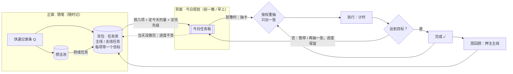
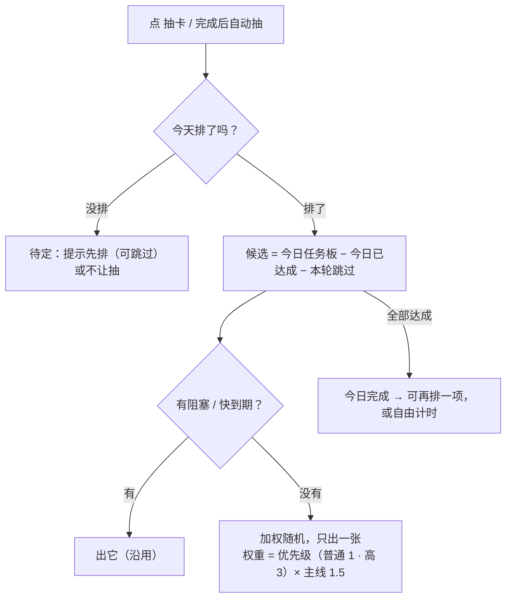

# 0.3.1：任务卡 RPG 化（今日任务板、背包抽屉、任务详情）

版本 v0.17 · 2026-11-05 · 状态：需求讨论中，未开工写代码。版本已同步为 `0.3.1-beta.1`（D0）。插入规则定稿（已定 19–38）：做卡时任何入口都是插入，快捷活动和临时活动永远是插入；插入卡边上整条宽的黑灰渐变，斜切成两块：左边大块是「回到任务」，右边一块是「结束原任务」，平时都不出字、鼠标放到哪块哪块才出；HTML 原型 `../原型/页面/insert-prototype.html` 等用户调好。待确认见「待用户确认（v0.16）」。下一步：插入卡原型定稿，再做今日任务板、背包抽屉、任务详情的原型，然后执行方案与 ADR。

## Current Plan（v0.17）

**开发与验收清单**

- [x] D0：同步版本为 `0.3.1-beta.1`（`npm run version:check` 通过；`npm run check` 通过，619 应用 + 12 MCP + 8 CLI，日志 `evidence/0.3.1-d0-check.log`）。本地提交，未推送。
- [x] v0.5 待确认 5 条（已定 14–18）。
- [x] 「插进来的事」待确认 4 条（已定 19–22）。
- [x] v0.7 待确认 3 条（已定 23、24；第 2 条在 v0.8 重问）。
- [ ] 插入卡原型（`../原型/页面/insert-prototype.html`）由用户调好并确认。
- [x] v0.8 待确认第 1 条（已定 25）。
- [ ] 流程图提议 7 条由用户确认。
- [ ] 原型与截图（今日任务板、背包抽屉、任务详情、排进今天浮层、完成对话框、设置开关），用户确认后同步 `../UI风格规范.md`。
- [ ] 执行方案与 ADR（今日任务板存法、抽卡规则、接着做、任务模式开关、`update_time_entry`）。

**以下为需求讨论记录。**

用户 2026-11-05 提出：现在的软件只用上了基本计时，任务卡难以落地；想按 RPG 游戏的任务方式重新组织，真正落实最初的设想（治拖延 / ADHD：犹豫时抽一张卡就去做，前提是提前规划）。

版本：用户决定 0.3.0 稳定版先发，本次大改放到 **0.3.1**。注意 `docs/版本开发流程.md` 第 2 节把补丁版定义为「只修 bug，不改数据格式」，本版会新增数据（今日任务板）并重做首页用法；按用户决定用 0.3.1，按小版本的要求做完整收尾（v0.4 已在流程文档第 2 节补了说明）。

### 一张纸的两面（用户的比喻）

- 正面：随笔，想到要做的事就写上去 → 软件里是快速记录条、想法池、背包里的任务。
- 背面：今天的规划，前一晚或早上挑几件、定好时间 → **今日任务板（新增）**。
- 第二天随机从规划里抽一件开始做 → 抽卡只从今日任务板里抽。

### 已定（2026-11-05）

1. **今日任务板**：从背包挑几项排进今天；抽卡只从今日任务板里抽（阻塞、快到期仍优先，沿用）。
2. **不要「开场固定项」**，改成调高抽卡概率：排进今天时给每项选优先级，按权重随机。权重暂定「普通 1 / 高 3」，主线再 ×1.5（沿用现有 `MAIN_CARD_WEIGHT`）。档位与数值待确认（v0.4 已定：普通 1 / 高 3）。
3. **背包搬进首页**，做成从底栏往上拉的抽屉（有抽屉动画，主观上仍在首页、仍在计时，思维不切换）；在首页直接点开。顶栏去掉「背包」。
4. **抽屉里的任务卡沿用现在背包的卡牌样式，信息量少一点**：一行进度条（一项一段：做完涂黑，时间盒按已计 / 目标涂强调色）、「做完几项 · 计时 累计 / 目标之和」、「下一项」、〔排进今天〕〔开始〕〔详情 ›〕。每项的小字、「计时记到」下拉、操作菜单挪进详情。
5. **任务详情**：在抽屉里点进去（‹ 返回背包），不换页面。列出全部子任务，包括已完成的（灰显并留在卡里）；每项有状态、进度条、类型与目标、〔排进今天〕/「今天已排」、〔开始〕，点一项编辑；底部添加子任务、计时记到、冷藏、放弃。
6. 进度按任务单独保留（卡的累计时长 = 这张卡所有计时条目之和，现有机制）。

线框：`../UI参考截图/v0.3.1-讨论-01-首页背包抽屉.svg`、`../UI参考截图/v0.3.1-讨论-02-抽屉任务卡与任务详情.svg`。

### 抽卡规则（v1，去掉开场项）

v0.4 起以 [0.3.1-flows.md](0.3.1-flows.md) 第 2 节为准；下图是 v0.1 的讨论稿，保留作记录。

工程上改纯函数 `src/domain/picker/pick.ts` 的候选池与权重，可单测。今日任务板单独存（如 `plans/<活动日>.yaml`），v0.2.5 / 0.3.0 是否忽略未知目录，开工前核对。

### 代码现状核对（v0.3，2026-11-05）

- 「开场固定项」就是 `pick.ts` 里的每日底线 `baseline()`：今天还没完成过主线卡时，固定出 `order` 最小的主线卡；还没完成过支线卡时，固定出 `order` 最小的支线卡。排在阻塞、回顾、快到期之后，加权随机之前。按已定第 2 条去掉。
- 抽卡顺序现在是：阻塞 → 每周回顾卡 → 快到期（`dueSoonHours`，默认 24 小时）→ 每日底线 → 加权随机（主线 1.5，`MAIN_CARD_WEIGHT` 是写死的常量）。候选是背包里任务的待做 / 进行中的卡，加上不属于任务的卡。完成后自动再抽一张（不自动开始）。
- 卡没有优先级字段。卡的类型只有「结果卡」（没有时间目标）和「时间盒卡」（`timebox_minutes`）。卡的累计时长不存，按计时条目的 `card_id` 现算。
- 「还要接着做」现在是：这张卡记为已完成，另建一张同内容的新卡放到队尾，新卡从 0 计时，两张卡只靠 `continued_from` 关联。「做到哪了」每张卡只存最新一条（`progress_note` 覆盖）。
- 没有任何功能开关；设置都是普通值。新加设置项要给默认值，旧的 `settings.yaml` 没有这个键。
- 新目录 `plans/`：v0.2.5 和 0.3.0 平时只列 `records/ cards/ tasks/ reviews/ timelog/ history/ .journal/`，不扫数据根目录，会忽略它；更新前备份会把它一起备份。新加枚举值（卡状态、任务状态）会让旧版读不了，要避免。
- 背包现在只有 01 任务池（主线 / 支线 / 冷藏）和 02 想法池两页；放弃的任务不显示。

### 已定（v0.4，用户 2026-11-05「按你推荐的来」）

v0.3 列的待确认 0–10 和附带需求的第 1 条，用户都选了推荐项。流程图见 [0.3.1-flows.md](0.3.1-flows.md)。

0. **版本**：先发 `0.3.1-beta.1` 到 Beta 渠道，测好再发 `0.3.1`。已同步版本（D0）。
1. **优先级**：普通 1 / 高 3，不加「低」；主线再 ×1.5。
2. **今天的量**：时间盒卡排进今天时可以填「今天做 N 分钟」，默认是剩下的时长；今天计够了就不再抽它，卡的总进度照常累计。结果卡不填，做完算达成。
3. **今天没排就点抽卡**：提示先去排，也可以选「今天先不排」；选了就从整个背包抽。
4. **今天没做完的**：第二天排今天时，昨天没做完的已经勾好，用户确认或去掉。
5. **还要接着做**：改成同一张卡接着做：不记完成，存下「做到哪了」，卡回到待做，累计时长接着算。回看里「完成的卡」只算真正做完的。
6. **任务模式开关**：关掉后隐藏抽卡、今日任务板、背包里的任务和回顾里的押注主线；计时、日历、列表、回看、想法池、快速记录照常，数据不删。默认开。
7. **抽屉分页**：〔任务 | 想法池〕两页（加上今日任务板），冷藏放在任务页最下面，和现在一样。
8. **前一晚规划**：今日任务板可以在〔今天 | 明天〕之间切换，前一晚直接排明天。
9. **〔排进今天〕的单位**：任务卡上的按钮只排「下一项」这一张卡；要多排几项，到详情里逐项排。
10. **没排进今天的阻塞 / 快到期卡**：自动加进今天的板子，照样优先抽。（v0.5 作废，改为已定第 11 条：不自动加入，规划时标红。）

附带需求第 1 条：**加 `update_time_entry`**（CLI / MCP 修改已有计时记录：开始、结束、描述、项目、标签，规则同日历，记操作历史）；不加删除。

### 已定（v0.5，用户 2026-11-05 看抽卡图后）

用户原话：「自动加进今天的卡……这个机制不能静默加入，只在安排当天事件的时候标红为当日过期」「我打算要删除阻塞机制」「回顾卡机制也不需要」。以下三条取代上面已定第 1 条里的「阻塞、快到期仍优先，沿用」和 v0.4 已定第 10 条。

11. **不自动加进今天**：没排进今天的卡不会被悄悄加进板子。规划时（排今天或明天、看背包任务和详情），到那天到期或已经过期的卡标红提醒，排不排由用户决定。
12. **删除阻塞机制**：快速记录条的〔阻塞〕、编辑事项的「阻塞」开关、背包里的 BLOCK 标记、CLI `todo add --blocking` 都去掉，抽卡不再看阻塞。为了退回 0.3.0 / 0.2.5，记录和卡的文件里仍写 `blocking: false`（旧版要求有这个字段）；旧的 MCP / CLI 调用带着 `blocking` 不报错，只是不起作用。
13. **抽卡不再出回顾卡**：首页不再出「每周回顾」卡和卡角的「开始回顾」；每周回顾从顶栏「回顾」进去，和现在一样。

### 已定（v0.6，用户 2026-11-05 回答 v0.5 的 5 条：「1.保留 2.B 3.B 4.A 5.B」）

14. **降级休息保留**，顺手修两个漏洞：分开布局下休息时计时条还能开始别的事；从背包直接开始一张卡会跳出休息、不经过〔回来〕。
15. **板子上快到期的卡不再固定先出**，只按权重随机；到期提醒只靠规划时标红。
16. **只标那天到期的卡**（已经过期的不标红）。
17. **旧卡上已有的阻塞标记不改文件**，0.3.1 里直接忽略；退回 0.3.0 时那几张又会排最前，用户接受。
18. **回顾卡去掉后不加提醒**，每周回顾和主线押注到期都要用户自己去顶栏「回顾」看。

### 新需求：插进来的事，做完回到原来的卡（v0.6，讨论中）

用户原话（2026-11-05，节选）：「今天我要做 ABC，做到 B 的途中，有一些别的事情插进来，我必须去处理。这个时候我会切到自由计时模式，把这件事记下来。记完之后，我要回到任务模式，回到原本的计划。这样的情况会出现很多。」「规划一般有很大的冗余，可能只会占一天 60% 的时间，额外增加的事情可能会占 40%。」「我在小窗口那里直接输入我要做什么，那我就直接切换到自由计时模式，那我换回去怎么办？」「抽卡只是一种选择……你决定了某些时候做什么事，你就可以直接做；除非你不知道做什么，才会抽卡。」「我换了东西之后，自动暂停……我可以选择返回。如果我要做 1 个小时，中间插了 20 分钟做别的事情，我希望后面做完那件事之后，接着前面那半小时往后做。」「在背包的抽屉里面是一个返回状态，你可以取消，直接当做这个事情就做到这儿，或者说是接着做。」

**现状**（读代码）：
- 底栏快捷活动选「插入」的（如厕所）和 0.2.5 的临时活动已经是这样：卡停在「进行中（暂停）」，首页右上角抽屉有〔回来〕，回来接着计这张卡，插进来的时间不算进卡（`insertInTx`、`resume_entry_id`）。
- 在主窗口计时框、小窗里直接输入，点收藏（默认「切换」）或「最近的记录」，走的是「切换」（`startFreeInTx`）：卡被放回待做，首页变成「现在做什么？」，没有回来的入口。要回去只能从背包或自动完成里重新开始这张卡。卡的累计时长不会丢（按计时条目现算）。

**提议的机制**（流程图见 [0.3.1-flows.md](0.3.1-flows.md) 第 10 节；v0.7 起以已定 19–22 为准：第 3 条的显示位置改成首页插入卡、上沿露出的任务卡和底栏，第 6 条的「直接开始另一张卡」改成不允许）：
1. 做卡途中，从任何入口开始别的事（计时框、小窗、收藏、最近的记录、快捷活动），卡都不放回待做，而是「等你回来」：卡暂停，插进来的事单独一条记录，不算进卡的时长。
2. 插进来的事可以接着换成别的事，也可以停掉，卡一直等着。
3. 「等你回来」显示在：背包抽屉顶部一栏（卡名、已做 / 今天的量、〔接着做〕〔就做到这儿〕）、首页那张卡（显示暂停中）、小窗〔↩ 回到 B〕。
4. 〔接着做〕：插进来的事结束，卡接着计，累计时长从上次停的地方往后加。
5. 〔就做到这儿〕：卡不再等，回到今日任务板，待做，进度保留，之后还能抽到或直接开始。
6. 直接开始另一张卡：原来等着的卡自动「就做到这儿」（同一时间只等一张）。换日时还在等的卡也自动「就做到这儿」，按已定第 4 条第二天确认带不带。

**待用户确认（v0.6）**：
1. 〔就做到这儿〕的意思：先停在这（回到板子上待做，可以写一句做到哪了），还是算这张卡完成？
2. 卡在等你回来时，能不能抽卡：不能（先选〔接着做〕或〔就做到这儿〕），还是能（抽到新卡时原来那张自动就做到这儿）？
3. 只对卡这样，还是自由计时之间也一样（自由计时「写报告」时插进来别的事，也能回到写报告）？
4. 0.2.5 的首页右上角临时活动抽屉：留着显示正在做的插进来的事和〔回来〕，和背包抽屉顶部那一栏同时有；还是只留背包抽屉那一栏？

### 已定（v0.7，用户 2026-11-05 回答 v0.6 的 4 条）

用户原话（节选）：「比如我今天要做 1 小时某个事，做了半小时后暂停，相当于放回背包……剩余半小时」「2.A 3.A」「快捷活动……我们现在讨论的是，我做某个任务卡要做的事情，也是插入进来，只不过这个插入进来不一定是快捷活动。本质上都是插入，所以我想把它们的 UI 统一。它应该是整个首页的覆盖，就像一张卡覆盖在任务卡上……在取消的时候，我就可以还原到正常的自由记录形式；没有取消的时候，就是插入形式……任何事件、快捷活动和插入活动的逻辑是相同的。」

19. **〔就做到这儿〕= 先停在这**：卡放回背包，仍在今日任务板上，待做，进度保留。今天的量按已做的扣：今天 60 分钟做了 30，板子上显示 30 / 60，还剩 30。之后再开始，卡的时间接着累计，不从 0 算；日历里是新的一段记录。
20. **卡在等你回来时不能抽卡**，先选〔接着做〕或〔就做到这儿〕。
21. **只对卡这样**；没在做卡时，开始别的事照常切换。（v0.9 补例外：快捷活动和临时活动永远是插入，见已定第 25 条。）
22. **插入统一**：做卡时，快捷活动、临时活动、计时框或小窗直接输入、收藏、最近的记录，开始的都是「插入」，同一套逻辑、同一个界面。界面是一张盖在任务卡上的「插入卡」，覆盖整个首页，取代 0.2.5 首页右上角的临时活动抽屉（ADR 0006 要改）。插入卡上有〔回到任务〕〔任务做到这儿〕；选了做到这儿，插入卡还原成普通的自由记录卡，插入的事接着计。插入卡的样子和动画由开发方设计，线框 `../UI参考截图/v0.3.1-讨论-03-插入卡.svg`、`-04-插入动画分镜.svg` 待用户确认。

### 已定（v0.8，用户 2026-11-05：「1.A … 3.你画的这个动画分镜要在原型里继续调试」）

23. **卡上的大读数显示今天在这张卡上做了多久**，和「今天 60 分钟」对得上；这张卡的总累计写在标题下面的小字里。
24. **插入卡按叠卡做**（线框 03、04 的分镜），在 HTML 原型里继续调：`../原型/页面/insert-prototype.html`（类名 `ins-` 前缀，左边「演示控制」能触发各种情况、调缩放 / 露出高度 / 浓淡 / 各段时长和缓动、切动效等级和窗口大小、复制参数），截图 `../UI参考截图/v0.3.1-插入原型-01..06-*.png`。原型里 `?selftest` 按「完整」动效走一遍插入、换内容、回到任务、做到这儿、自由计时时切换，2026-11-05 无头 Edge 跑过，结果 OK。真窗口和正式代码都还没做。

### 已定（v0.9，用户 2026-11-05 回答 v0.8 第 1 条：「A」）

25. **快捷活动和临时活动永远是插入**：做卡时、自由计时时都盖插入卡，回来接着原来那件事（自由计时时插入卡的按钮是〔回到原来的事〕〔原来的事不回了〕）。设置 05 里快捷活动、收藏每一项的「切换 / 插入」去掉：快捷活动一律插入，收藏一律按第 21、22 条（做卡时插入，自由计时时切换）。计时框、小窗、最近的记录同收藏。原型已按这条改，去掉了「待定」开关。

### 已定（v0.10，用户 2026-11-05）

用户原话：「这个任务做到这，是指被插入任务，应该改成结束原任务，点击会提醒是否要结束"xxx"，然后灰字备注 若未完成则重新放入背包。」

26. **〔任务做到这儿〕改名〔结束原任务〕**（英文小字 END），点了先弹确认：标题「结束「学 408：读第 4 章」？」，下面灰字「若未完成，则重新放入背包。」，按钮〔取消〕〔结束〕；Esc 和点遮罩等于取消。结束后的效果不变（同已定第 19 条：卡放回背包，仍在今日任务板上，进度保留；插入卡变成普通自由记录卡）。自由计时时同样改成〔结束原来的事〕，确认框写「结束「写周报」？」和「这条自由记录到此为止，插入的事接着计。」。原型已改，截图 `v0.3.1-插入原型-07-结束原任务确认.png`，02、03、06 重拍，04 改名为「结束原任务以后」。本计划前面写的〔任务做到这儿〕〔就做到这儿〕，都按这条读作〔结束原任务〕。

### 已定（v0.11，用户 2026-11-05）

用户原话：「这样我们 UI 设计稍微有活力一点：下面的『回到原来』这个按钮，你看它现在是从上往下的抽屉嘛，你就把它换成一个很大块、整个长度的、向上的渐变箭头区域，里面有个箭头……就是一个很大的平面设计，你往上走的话，上面就是一个大口子。」

27. **〔回到任务〕改成插入卡边上整条宽的回去区域**：横跨整张插入卡，强调色向上（或向下）渐变到透明，里面一个大的实心向上箭头，旁边「回到任务 / BACK TO QUEST」和「学 408：读第 4 章 · 25:00 / 60:00」，点整块回去。按钮那一排不再有〔回到任务〕，只剩〔结束原任务〕〔暂停〕〔停止〕。动效「完整」时箭头上下浮动；鼠标放上去，插入卡先往上抬一点（默认 14px），像要被推回上面。原型里两种位置都做了：底边（默认，像抽屉的把手，往上推回去）和顶边（箭头指着上面露出的任务），左边「回去区域」可切换，也能调高度和抬起多少；截图 02、03、06、07 重拍（底边），08 是顶边。上沿露出的任务那一条、底栏「↩ 等你回来」照样能点回去。

### 已定（v0.12，用户 2026-11-05）

用户原话：「它这个太显眼了。比如我在做插入任务时，你可以用你的强调色显示。这个强调色不显示文字，等鼠标移上去才会显示文字。不然你看一眼当前时间，一看就是 4 个大字『回到任务』，比较扰乱心神。然后这个强调色渐变稍微不均匀一点。」

28. **回去区域平时只有颜色，不出字**：鼠标放上去（或键盘移到上面）才出「回到任务 / BACK TO QUEST」和「学 408：读第 4 章 · 25:00 / 60:00」，字从箭头右边展开，颜色同时变浓；离开就收起。平时默认带一个很淡的箭头（不透明度 30%），原型里可以换成「只有颜色」。渐变改成几团深浅不一的光叠在一起（左边最浓、中间最淡、右边次之），边上一定淡到没有、不留硬边；动效「完整」时这几团光 14 秒一个来回慢慢左右飘，可关。箭头只在鼠标放上去时跳，平时不动。区域默认高 76px。截图 02、03、06、07、08 重拍，09 是鼠标放上去的样子。

### 已定（v0.13，用户 2026-11-05：「渐变色颜色改为黑灰色呢？感觉现在这个也太绿了」）

29. **回去区域的渐变改成黑灰**（墨色 `--ink`，几团光的浓淡同第 28 条：左边最浓、中间最淡、右边次之）。平时的淡箭头是白色；鼠标放上去渐变变成接近黑底，字是白的，箭头换成强调色（强调色只放在黑底上，合 UI 风格规范）。原型左边「回去区域 → 颜色」可以切回强调色对比。截图 02、03、06、07、08、09 重拍。

### 已定（v0.14，用户 2026-11-05：「常驻状态下的颜色改淡一点点，然后你改成黄色的强调色试试」）

30. **回去区域平时的颜色再淡一点**：黑灰几团光的浓度 70/26/52/14% → 58/20/44/11%，强调色版 94/46/80/24% → 82/38/68/20%；鼠标放上去的浓度不变。

原型加了「强调色（同设置 06 外观）」一栏，四个选项和正式软件一样（信号黄 / 薄荷绿 / 天青 / 警示橙），按用户说的先切到信号黄。截图 02、03、06–09 是薄荷绿（平时已按第 30 条变淡），10–13 是信号黄的对比：黑灰渐变平时 / 鼠标放上去、黄色渐变平时 / 鼠标放上去。

### 已定（v0.15，用户 2026-11-05）

用户原话：「把这个"结束原任务"放在渐变处的右边，用一个比较融协调的方式，你想办法融入那上面。类似于：鼠标移上去是"回到任务"，鼠标再移到右边的位置，会显示"是否结束当前任务"。这样子也是一个平面设计吧，你想想怎么办。」

31. **〔结束原任务〕并进回去区域的右边**：同一条渐变用一道斜切（斜边宽 26px）分成两块，左边大块 =〔回到任务〕，右边一块 =〔结束原任务〕。按钮那一排只剩〔暂停〕/〔继续〕和〔停止〕（取代第 27 条里「只剩〔结束原任务〕〔暂停〕〔停止〕」）。
    - 平时：看着还是一整条，没有字。左边一个淡的向上箭头（回到任务），右边一个淡的向下箭头（同一个箭头倒过来，往下 = 放回背包）。右边那块平时窄，宽 `clamp(180px, 20%, 260px)`。
    - 鼠标在左边：整条变暗（左边全浓，右边 82%），斜切线淡淡出现。左边出字，同第 28、29 条；右边只露一行淡字「结束原任务」和淡的向下箭头。插入卡往上抬，同第 27 条。
    - 鼠标移到右边：右边往左展开到 `clamp(380px, 46%, 580px)`，斜切跟着滑过去，底色加实，左边退到 45%。右边出「是否结束「学 408：读第 4 章」？」，下面灰字「若未完成，则重新放入背包」。斜切线和向下箭头变成提醒色（黑灰版用 `--over`，强调色版用 `--red`）。插入卡不抬。
    - 点右边：默认点一下就结束，因为鼠标放上去时已经问过了。第 26 条的确认框改成可选：原型「回去区域」一栏可以换成「再点一下」（第一次点后问句变成「再点一下，结束」，3 秒内或鼠标离开前再点才结束），或「弹确认框」（同第 26 条）。结束后的效果不变，同第 19、26 条。
    - 自由计时时：右边淡字是「结束原来的事」，灰字「这条自由记录到此为止」。
    - 放顶边时一样，斜切方向反过来，字贴着顶边。原型把渐变和遮罩挪到了底层，字不再跟着渐变一起淡掉（顶边时灰字原来看不清）。

截图：02、03、06–09 重拍（薄荷绿），10–13 重拍（信号黄）。新增 14「鼠标放在结束区域上」、15「结束区域-顶边」、16「结束区域-960x600」、17「信号黄-黄色渐变-鼠标放在结束区域」（都是信号黄）。07 的确认框现在只在「弹确认框」时出现。

原型自测（`?selftest`）通过，覆盖：平时右边没有字；三种点法（弹确认框的打开和取消、再点一下、结束）；自由计时时右边的字。截图里的「鼠标放上去」是用 `&hover` / `&hover=end` 加的样式，不是真鼠标。**未测**：真鼠标移动时展开 / 收起的动画和左右来回移动的手感、键盘 Tab 到右边那块、「再点一下」状态的样子（没截图）。

### 已定（v0.16，用户 2026-11-05）

用户原话：「1和前面说的一样，显示弹窗是否结束 2不用，为啥要加这个，结束原任务和停止按钮不就是两个任务的结束吗，再加做完了是何意味 3设置可选 4不用 5你加一个灰白试试 6先等下 7这个在调」

32. **点右边那块弹确认框**：同第 26 条，标题「结束「xxx」？」、灰字、〔取消〕〔结束〕。取代第 31 条里「默认点一下就结束」和两种可选点法，原型去掉「点一下就结束 / 再点一下」。鼠标放上去时右边照旧出「是否结束「xxx」？」作提示。
33. **不加〔做完了〕**：〔结束原任务〕结束的是原任务，〔停止〕结束的是插入的事，已经够了（v0.10 待确认第 0 条作废）。
34. **回去区域放底边还是顶边做成设置项**，用户自选。默认值和放在设置哪一页留到写执行方案时定（原型默认底边）。
35. **默认强调色不改**，仍是薄荷绿；信号黄只是原型里试过。原型默认强调色改回薄荷绿。
36. **回去区域颜色加「灰白」试看**：和黑灰、强调色并列，原型「回去区域 → 颜色」三选一。灰白版平时是浅灰的光（`#b4b4ae`），鼠标放上去变浅灰底（`#c4c4be`）、墨色字、墨色箭头，斜切线和向下箭头用 `--red`。还没定用哪种。
37. 流程图第 8 节 7 条提议：用户说先等。原型参数：用户在调。

截图：07「结束原任务确认」、14「鼠标放在结束区域上」按薄荷绿重拍；新增 18「灰白-平时」、19「灰白-鼠标放上去」、20「灰白-鼠标放在结束区域」、21「灰白-顶边-结束区域」。10–13、15–17 是 v0.15 的信号黄截图，没有重拍，其中 15–17 拍的时候点法还是「点一下就结束」，样子没变。原型自测（`?selftest`）通过，覆盖右边点了弹框、取消、结束。**未测**：真鼠标手感、键盘 Tab。

### 已定（v0.17，用户 2026-11-05）

用户原话：「你那根斜线不要把它去掉。比如你把鼠标移上去之后，在右边用渐变的方式（就像你现在渐变的方式），是红色的"烟雾状"，然后你那个箭头去掉，只显示"结束原任务"」（理解为：斜线不要，去掉。）

38. **右边那块改成红色烟雾**：去掉斜切线和向下箭头，左右两块不再斜切重叠。鼠标放上去，右边从卡片边升起一团红色烟雾（`--red`，几团深浅不一的光叠成，同回去区域的做法，往卡里和往左都淡到没有，动效「完整」时慢慢飘），上面只写白字「结束原任务」（自由计时时「结束原来的事」），不再显示「是否结束「xxx」？」和灰字。点了照旧弹确认框（第 32 条）。黑灰、灰白、强调色三种颜色下，烟雾都是红色。

截图：14、20、21 重拍；新增 22「红烟雾-黑灰」、23「红烟雾-灰白」、24「红烟雾-灰白-顶边」、25「红烟雾-960x600」。15–17 是旧样子（斜线和问句），没重拍。原型自测（`?selftest`）通过，新增检查：右边没有斜线、箭头和问句。**未测**：真鼠标手感。

### 待用户确认（v0.16，v0.17 未新增）

1. **回去区域的颜色**：黑灰、灰白，还是跟着强调色？
2. **原型参数**（用户在调）：调好后「复制当前参数」发回，或直接说哪里改。
3. 流程图 [0.3.1-flows.md](0.3.1-flows.md) 第 8 节的 7 条提议（用户说先等）。

### 待用户确认（v0.15，已于 v0.16 定下）

1. **右边那块点了以后**：点一下就结束（默认），再点一下才结束，还是照旧弹确认框？（v0.16 定：弹确认框）

### 待用户确认（v0.14，已于 v0.16 定下或并入 v0.16）

1. **强调色**：只是这张原型试黄色，还是正式软件的默认强调色也改回信号黄？（现在默认是薄荷绿，0.2.5 改的；用户自己可以在设置 06 换，已有设置不受默认值影响。）
2. **回去区域的颜色**：黑灰（已定第 29 条），还是跟着强调色（黄色时是截图 12、13）？

### 待用户确认（v0.11，v0.16 定：做成设置项）

- 回去区域放底边还是顶边（原型里切着看）。

### 待用户确认（v0.10，第 0 条 v0.16 定：不加；其余并入 v0.16）

0. 原任务其实已经做完了时：确认框里要不要多一个〔做完了〕（等于完成这张卡，走完成对话框）？现在只能先〔回到任务〕再点〔完成〕。
1. **原型里的叠卡参数和动画**（v0.8 第 2 条）：用户在 `../原型/页面/insert-prototype.html` 里调好后，把「复制当前参数」的结果发回来，或者直接说哪里要改。
2. 流程图 [0.3.1-flows.md](0.3.1-flows.md) 第 8 节的 7 条提议。

### 待用户确认（v0.8，第 1 条已于 v0.9 定下）

1. **没在做卡时的快捷活动和临时活动**（v0.7 第 2 条重问；v0.9 定：A）。用户问「临时活动不是只有插入吗？右上角抽屉」。现状是：临时活动永远是插入；底栏快捷活动和计时条收藏的每一项在设置 05 里都有「切换 / 插入」可选，快捷活动默认插入，收藏默认切换；插入时不管有没有在做卡，都出右上角临时活动抽屉，回来接着原来那件事（自由计时的也能回）。要定的是 0.3.1 里自由计时时还保不保留这种插入：
   - A. 保留：快捷活动和临时活动永远是插入，做卡、自由计时都盖插入卡，回来接着原来那件事；设置 05 里每项的「切换 / 插入」去掉；收藏、计时框、小窗、最近的记录在做卡时插入、自由计时时切换。
   - B. 不保留：只有做卡时才有插入，自由计时时一律切换。
   原型左边「待定」那一栏可以切换两种看效果。
2. **原型里的叠卡参数和动画**：用户在原型里调好后，把「复制当前参数」的结果发回来，或者直接说哪里要改。

### 待用户确认（v0.7，已于 v0.8 定下或重问）

1. **卡上的大读数**：显示今天在这张卡上做了多久（和「今天 60 分钟」对得上，总累计写在卡头小字），还是这张卡一共做了多久（现在的做法：所有天加起来）？（v0.8 定：今天的）
2. **没在做卡时的快捷活动**：现在快捷活动有「切换 / 插入」设置，插入型的（如厕所）在自由计时时也能回到原来那条。统一成切换、去掉这个设置，还是自由计时时照旧？（v0.8 重问，见上）
3. **插入卡的样子**：叠卡（任务卡退到后面、上沿露出一条，插入卡盖在上面；线框 03、04），书签（任务卡缩成左上角一个书签），还是底栏条（任务卡缩成底栏上方一条，像音乐软件的「正在播放」）？（v0.8 定：叠卡，在原型里继续调）

### 待用户确认（v0.6，已于 v0.7 定下）

见上方「新需求：插进来的事」里的待确认 1–4。

### 待用户确认（v0.5，已于 v0.6 定下）

1. **降级休息**（30 分钟内「缩小」「再抽一张」累计 4 次自动进休息，见 [0.3.1-flows.md](0.3.1-flows.md) 第 9 节）：保留，还是删掉？保留的话，顺手修两个漏洞：分开布局下休息时还能在计时条开始别的事；从背包直接开始一张卡会跳出休息，不经过〔回来〕（都是读代码发现，未实测）。
2. **板子上快到期的卡**：还是固定先出（24 小时内到期，沿用 `dueSoonHours`），还是只按权重随机？
3. **标红的范围**：到那天到期的和已经过期的都标红，还是只标到那天到期的？
4. **旧卡上已有的阻塞标记**：不改文件、0.3.1 里直接忽略（退回 0.3.0 时那几张又会排最前），还是升级时统一改成不阻塞？
5. **回顾卡去掉后的提醒**：顶栏「回顾」上加一个小红点（回顾到期时出现，做完消失；主线押注到期也靠它提醒），还是不提示？现在首页的回顾卡是回顾到期和押注到期唯一的主动提醒。

### 待用户确认（v0.4）

画流程图时遇到的 8 条提议，见 [0.3.1-flows.md](0.3.1-flows.md) 第 8 节：「今天先不排」管多久、自动加入的卡移出后不再加（v0.5 作废：不再自动加入）、时间盒卡到量只提醒、直接开始没排的卡不进板子、缩小时板子上换成子卡、换日时还在计的卡自动带过去、带过去的量怎么取、做完一项后下一项不自动排。

### 待用户确认（v0.3，已于 v0.4 定下）

0. 开发版本号：先发 `0.3.1-beta.1` 到 Beta 渠道（首页用法改动大），还是直接 `0.3.1`；或者改叫 `0.4.0`（流程文档把补丁版定义为只修 bug）。
1. 优先级档位：「普通 1 / 高 3」可以吗？要不要「低」？
2. 今天的量：排进今天时「今天做 1 小时」是否和卡本身的总目标分开？
3. 今天没排时：提示先排（可跳过），还是不让抽？
4. 当天没做完的：第二天自动排回今天，还是回背包等重新挑？
5. 「还要接着做」改成同一张卡继续、进度不断（现在会新建一张卡、从 0 算）？
6. 任务模式开关（用户原话「任务卡功能可以设为需要单独启用」）：关掉后保留哪些（计时、日历、列表、回看、想法池）？
7. 想法池、冷藏的任务在抽屉里放哪一页。
8. 前一晚规划：前一晚排的是「明天」吗？今天的板子之外要不要能切到明天？（活动日按 `dayBoundaryHour` 换日，前一晚 23 点还算今天。）
9. 排进今天的单位：任务卡上的〔排进今天〕排的是「下一项」这一张卡，还是整个任务（抽到这个任务时出它最前面没做完的那项，做完一项后面的接着能抽）？
10. 阻塞或快到期、但没排进今天的卡：照样优先抽、自动加进今天的板子，还是不抽只提示？

### 附带需求：CLI / MCP 做不到时，agent 要告诉用户，不能自己改数据文件（2026-11-05 加入）

与任务卡 RPG 化无关，单独一项，用户决定放进本版。

**起因**：2026-11-05 一个 agent 想改一条已有的计时记录，CLI 没有这个命令，它就直接改了 `F:\单轨\timelog\2026-11-05.md`（13:36:43 单轨写入，13:38:02 被外部原地改写，把「游戏」拆出一条「吃饭」；`history/` 里没有对应的操作记录）。单轨内存里的计时索引只在启动时读一次，之后的计时操作因磁盘内容与索引不一致被拒绝，弹出「出错了 · External edit: timelog/2026-11-05.md」，要重启单轨才能恢复。

**用户要求**：至少在提示词层面让 agent 先知道：CLI 没有这个命令、MCP 没有这个工具或权限时，要回来告诉用户做不到、缺什么，不能自己去改数据目录里的文件、也不能写脚本绕过。

**做什么**（文案统一一份，几处共用，建议放 `src/shared`）：

1. MCP 握手说明：`mcp/server.ts` 的 `new McpServer(...)` 传第二个参数 `{ instructions }`（`@modelcontextprotocol/server` 2.4.0 已支持），写入上述规则。现在没有设置。
2. MCP `get_context` 工具描述末尾补一句同样的规则（agent 写操作前都会先调它）。
3. CLI `--help`：`cli/output.ts` 的 `renderHelpText()` 在标题行下面先写这条规则。`--help --json` 是否加字段，开工时定（加字段算 CLI 输出格式变化，要同步 `docs/application/README.md`）。
4. CLI 做不到时的报错：`cli/commands.ts` 的未知命令报错和 `CliUsageError` 默认 `nextStep`，从「运行 monorail --help 查看…」改成同时说明：CLI 没有这个功能，停下告诉用户缺什么，不要直接改单轨数据目录里的文件。
5. 文档：`mcp/README.md`、`docs/application/README.md` 写明这条规则。

文案草稿（开工时再定稿）：

> 单轨的数据目录（timelog/、records/、cards/ 等）只能由单轨程序读写。直接修改这些文件不会记入操作历史，还会让单轨之后的操作报「External edit」而失败。如果 CLI 没有你需要的命令、MCP 没有你需要的工具或权限，请停下并告诉用户：做不到，缺的是什么功能。不要改文件、写脚本或用其他办法绕过。

**怎么算做完**：

- MCP 初始化结果里带 `instructions`，内容为上述规则；`get_context` 描述含规则。有测试断言。
- `monorail --help` 输出开头含规则；未知命令的报错（人读与 `--json` 两种）含规则。`cli/cli.test.ts` 里断言旧文案的用例同步更新。
- `npm run check` 通过。
- 用真实 agent 试一次「改一条已有计时记录」，看它是否回来告诉用户而不是改文件：可选，结果记 evidence；没试就写「未实测」。

**不在范围内**：这只是提示词层面的约束，agent 仍有权限改文件，挡不住执意绕过的情况。真正禁止需要让 agent 用另一个 Windows 账号运行、数据目录 ACL 只给本人账号；这要改命名管道的访问权限（`src-tauri/src/mcp_bridge.rs` 现在用默认安全设置，其他账号连不上），以及 CLI 找管道的方式（现在读本人 `%APPDATA%` 下的 `config.json` / `mcp-host.json`）。本版不做，以后要做再单独立项。

**待用户确认**：

1. 要不要同时给 CLI / MCP 加「修改已有计时记录」的命令？这次 agent 绕路的直接原因就是缺这个功能。**v0.4 定：加修改（`update_time_entry`），不加删除。**

## Revision History

| 版本 | 日期 | 变更 |
|---|---|---|
| v0.1 | 2026-11-05 | 记录用户提出的任务卡 RPG 化方向与已定 6 条（今日任务板、按权重抽卡不要开场项、背包首页抽屉、抽屉任务卡精简、任务详情、进度单独保留）；用户决定先发 0.3.0 稳定版、本版定为 0.3.1；待确认 7 条；未开工 |
| v0.2 | 2026-11-05 | 加入附带需求：CLI / MCP 做不到时 agent 要告诉用户，不能自己改数据文件（MCP instructions、get_context 描述、CLI --help 与未知命令报错、文档）；起因是 agent 直接改 timelog 导致 External edit；硬隔离不在本版范围；待确认 1 条（是否加修改已有计时记录的命令）；未开工 |
| v0.3 | 2026-11-05 | 0.3.0 已发布，继续需求讨论：补代码现状核对（开场项即每日底线、还要接着做会新建卡、无优先级与功能开关、`plans/` 旧版会忽略）；待确认加第 0 条（开发版本号）与第 8–10 条（前一晚规划、排进今天的单位、没排进今天的阻塞 / 快到期卡）；未开工 |
| v0.4 | 2026-11-05 | 用户选全部推荐项，记为已定 0–10 与附带需求第 1 条（加 `update_time_entry`）；同步版本 `0.3.1-beta.1`（D0），流程文档第 2 节补 0.3.1 说明；新增流程图 `0.3.1-flows.md`，其中 8 条提议待确认；加开发与验收清单；未开工写代码 |
| v0.5 | 2026-11-05 | 用户看抽卡图后定：不自动加进今天、规划时标红（取代已定第 10 条）；删除阻塞机制（文件仍写 `blocking: false` 保退回）；抽卡不再出回顾卡。新增待确认 5 条（降级休息去留、板子上快到期是否先出、标红范围、旧阻塞标记、回顾提醒）；流程图提议第 2 条作废；未开工写代码 |
| v0.6 | 2026-11-05 | 用户回答 v0.5 的 5 条，记为已定 14–18（保留降级休息并修漏洞、快到期不再先出、只标那天到期、旧阻塞标记不改、不加回顾提醒）；记录新需求「插进来的事，做完回到原来的卡」的现状与提议机制，待确认 4 条；未开工写代码 |
| v0.7 | 2026-11-05 | 用户回答 v0.6 的 4 条，记为已定 19–22（就做到这儿 = 先停在这、等你回来时不能抽卡、只对卡、插入统一成覆盖首页的插入卡并取代临时活动抽屉）；新增线框 `v0.3.1-讨论-03-插入卡.svg`、`-04-插入动画分镜.svg`；待确认 3 条（大读数、自由计时时的快捷活动、插入卡样式）；未开工写代码 |
| v0.8 | 2026-11-05 | 用户定大读数显示今天的（已定 23）、插入卡按叠卡分镜在原型里继续调（已定 24）；新增原型 `../原型/页面/insert-prototype.html` 与截图 `v0.3.1-插入原型-01..06`；重问自由计时时快捷活动 / 临时活动是否保留插入；未开工写代码 |
| v0.9 | 2026-11-05 | 用户选 A：快捷活动和临时活动永远是插入，设置 05 的「切换 / 插入」去掉（已定 25，第 21 条补例外）；原型去掉待定开关、自测补自由计时时插入与回来；待确认剩原型参数和流程图 7 条提议；未开工写代码 |
| v0.10 | 2026-11-05 | 用户要求〔任务做到这儿〕改名〔结束原任务〕并先确认（已定 26）；原型加确认框、自测覆盖打开 / 取消 / 结束，截图 07 新增、02/03/06 重拍；新增待确认第 0 条（确认框里要不要〔做完了〕）；未开工写代码 |
| v0.11 | 2026-11-05 | 用户要求〔回到任务〕改成整条宽、向上渐变的大箭头区域（已定 27）；原型做了底边 / 顶边两种并可调，自测加回去区域检查，截图 02/03/06/07 重拍、08 新增；待确认加「放底边还是顶边」；未开工写代码 |
| v0.12 | 2026-11-05 | 用户嫌回去区域太显眼：平时只有不均匀的强调色渐变（带淡箭头），鼠标放上去才出字（已定 28）；自测加「平时没有字」，截图 02/03/06/07/08 重拍、09 新增；未开工写代码 |
| v0.13 | 2026-11-05 | 用户嫌太绿：回去区域渐变改黑灰，悬停时黑底白字、箭头强调色（已定 29）；原型可切回强调色，截图 02/03/06/07/08/09 重拍；未开工写代码 |
| v0.14 | 2026-11-05 | 回去区域平时的颜色再淡一点（已定 30）；原型加强调色切换并试信号黄，截图 02/03/06–09 重拍（薄荷绿）、10–13 新增（信号黄对比）；待确认加强调色默认值、回去区域用黑灰还是强调色；未开工写代码 |
| v0.15 | 2026-11-05 | 〔结束原任务〕并进回去区域右边，斜切分两块，鼠标放到右边才问「是否结束「xxx」？」（已定 31）；第 26 条的确认框改为可选，第 27 条的按钮排只剩〔暂停〕〔停止〕；截图 02/03/06–13 重拍、14–17 新增；自测通过，真鼠标手感未测；待确认加右边点法；未开工写代码 |
| v0.16 | 2026-11-05 | 用户定：右边点了弹确认框（已定 32）、不加〔做完了〕（33）、底边 / 顶边做成设置项（34）、默认强调色不改（35）；回去区域加灰白试看（36）；原型去掉点法切换、默认强调色回薄荷绿，自测通过，截图 07/14 重拍、18–21 新增；待确认剩颜色、原型参数、流程图 7 条；未开工写代码 |
| v0.17 | 2026-11-05 | 右边那块去掉斜线和箭头，鼠标放上去升起红色烟雾、只写「结束原任务」（已定 38）；自测通过，截图 14/20/21 重拍、22–25 新增；未开工写代码 |
