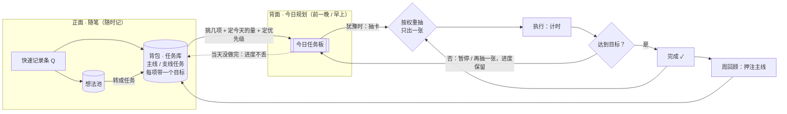
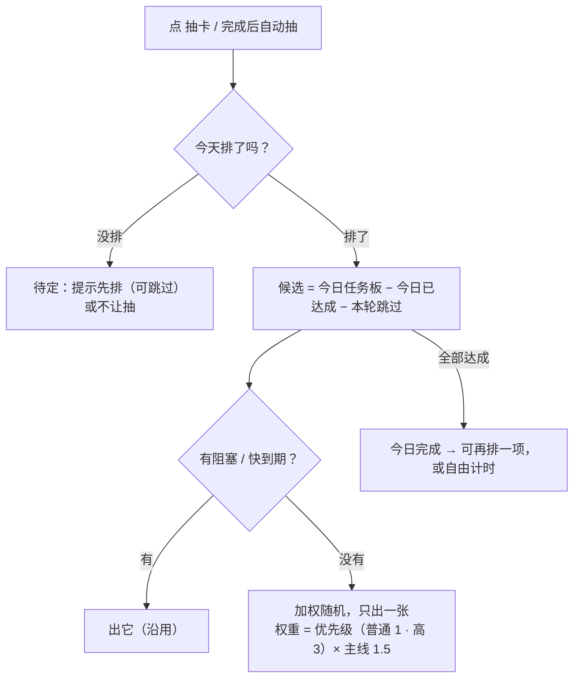

# 0.3.1：任务卡 RPG 化（今日任务板、背包抽屉、任务详情）

版本 v0.5 · 2026-11-05 · 状态：需求讨论中，未开工写代码。版本已同步为 `0.3.1-beta.1`（D0）。v0.5 按用户意见去掉阻塞、回顾卡和「自动加进今天」，改成规划时标红；还有 5 条待确认（见下方「待用户确认（v0.5）」），流程图 [0.3.1-flows.md](0.3.1-flows.md) v0.2 里 7 条提议也待确认。下一步：原型与截图、执行方案、ADR。

## Current Plan（v0.5）

**开发与验收清单**

- [x] D0：同步版本为 `0.3.1-beta.1`（`npm run version:check` 通过；`npm run check` 通过，619 应用 + 12 MCP + 8 CLI，日志 `evidence/0.3.1-d0-check.log`）。本地提交，未推送。
- [ ] v0.5 待确认 5 条、流程图提议 7 条由用户确认。
- [ ] 原型与截图（今日任务板、背包抽屉、任务详情、排进今天浮层、完成对话框、设置开关），用户确认后同步 `../UI风格规范.md`。
- [ ] 执行方案与 ADR（今日任务板存法、抽卡规则、接着做、任务模式开关、`update_time_entry`）。

**以下为需求讨论记录。**

用户 2026-11-05 提出：现在的软件只用上了基本计时，任务卡难以落地；想按 RPG 游戏的任务方式重新组织，真正落实最初的设想（治拖延 / ADHD：犹豫时抽一张卡就去做，前提是提前规划）。

版本：用户决定 0.3.0 稳定版先发，本次大改放到 **0.3.1**。注意 `docs/版本开发流程.md` 第 2 节把补丁版定义为「只修 bug，不改数据格式」，本版会新增数据（今日任务板）并重做首页用法；按用户决定用 0.3.1，按小版本的要求做完整收尾（v0.4 已在流程文档第 2 节补了说明）。

### 一张纸的两面（用户的比喻）

- 正面：随笔，想到要做的事就写上去 → 软件里是快速记录条、想法池、背包里的任务。
- 背面：今天的规划，前一晚或早上挑几件、定好时间 → **今日任务板（新增）**。
- 第二天随机从规划里抽一件开始做 → 抽卡只从今日任务板里抽。

### 已定（2026-11-05）

1. **今日任务板**：从背包挑几项排进今天；抽卡只从今日任务板里抽（阻塞、快到期仍优先，沿用）。
2. **不要「开场固定项」**，改成调高抽卡概率：排进今天时给每项选优先级，按权重随机。权重暂定「普通 1 / 高 3」，主线再 ×1.5（沿用现有 `MAIN_CARD_WEIGHT`）。档位与数值待确认（v0.4 已定：普通 1 / 高 3）。
3. **背包搬进首页**，做成从底栏往上拉的抽屉（有抽屉动画，主观上仍在首页、仍在计时，思维不切换）；在首页直接点开。顶栏去掉「背包」。
4. **抽屉里的任务卡沿用现在背包的卡牌样式，信息量少一点**：一行进度条（一项一段：做完涂黑，时间盒按已计 / 目标涂强调色）、「做完几项 · 计时 累计 / 目标之和」、「下一项」、〔排进今天〕〔开始〕〔详情 ›〕。每项的小字、「计时记到」下拉、操作菜单挪进详情。
5. **任务详情**：在抽屉里点进去（‹ 返回背包），不换页面。列出全部子任务，包括已完成的（灰显并留在卡里）；每项有状态、进度条、类型与目标、〔排进今天〕/「今天已排」、〔开始〕，点一项编辑；底部添加子任务、计时记到、冷藏、放弃。
6. 进度按任务单独保留（卡的累计时长 = 这张卡所有计时条目之和，现有机制）。

线框：`../UI参考截图/v0.3.1-讨论-01-首页背包抽屉.svg`、`../UI参考截图/v0.3.1-讨论-02-抽屉任务卡与任务详情.svg`。

### 抽卡规则（v1，去掉开场项）

v0.4 起以 [0.3.1-flows.md](0.3.1-flows.md) 第 2 节为准；下图是 v0.1 的讨论稿，保留作记录。

工程上改纯函数 `src/domain/picker/pick.ts` 的候选池与权重，可单测。今日任务板单独存（如 `plans/<活动日>.yaml`），v0.2.5 / 0.3.0 是否忽略未知目录，开工前核对。

### 代码现状核对（v0.3，2026-11-05）

- 「开场固定项」就是 `pick.ts` 里的每日底线 `baseline()`：今天还没完成过主线卡时，固定出 `order` 最小的主线卡；还没完成过支线卡时，固定出 `order` 最小的支线卡。排在阻塞、回顾、快到期之后，加权随机之前。按已定第 2 条去掉。
- 抽卡顺序现在是：阻塞 → 每周回顾卡 → 快到期（`dueSoonHours`，默认 24 小时）→ 每日底线 → 加权随机（主线 1.5，`MAIN_CARD_WEIGHT` 是写死的常量）。候选是背包里任务的待做 / 进行中的卡，加上不属于任务的卡。完成后自动再抽一张（不自动开始）。
- 卡没有优先级字段。卡的类型只有「结果卡」（没有时间目标）和「时间盒卡」（`timebox_minutes`）。卡的累计时长不存，按计时条目的 `card_id` 现算。
- 「还要接着做」现在是：这张卡记为已完成，另建一张同内容的新卡放到队尾，新卡从 0 计时，两张卡只靠 `continued_from` 关联。「做到哪了」每张卡只存最新一条（`progress_note` 覆盖）。
- 没有任何功能开关；设置都是普通值。新加设置项要给默认值，旧的 `settings.yaml` 没有这个键。
- 新目录 `plans/`：v0.2.5 和 0.3.0 平时只列 `records/ cards/ tasks/ reviews/ timelog/ history/ .journal/`，不扫数据根目录，会忽略它；更新前备份会把它一起备份。新加枚举值（卡状态、任务状态）会让旧版读不了，要避免。
- 背包现在只有 01 任务池（主线 / 支线 / 冷藏）和 02 想法池两页；放弃的任务不显示。

### 已定（v0.4，用户 2026-11-05「按你推荐的来」）

v0.3 列的待确认 0–10 和附带需求的第 1 条，用户都选了推荐项。流程图见 [0.3.1-flows.md](0.3.1-flows.md)。

0. **版本**：先发 `0.3.1-beta.1` 到 Beta 渠道，测好再发 `0.3.1`。已同步版本（D0）。
1. **优先级**：普通 1 / 高 3，不加「低」；主线再 ×1.5。
2. **今天的量**：时间盒卡排进今天时可以填「今天做 N 分钟」，默认是剩下的时长；今天计够了就不再抽它，卡的总进度照常累计。结果卡不填，做完算达成。
3. **今天没排就点抽卡**：提示先去排，也可以选「今天先不排」；选了就从整个背包抽。
4. **今天没做完的**：第二天排今天时，昨天没做完的已经勾好，用户确认或去掉。
5. **还要接着做**：改成同一张卡接着做：不记完成，存下「做到哪了」，卡回到待做，累计时长接着算。回看里「完成的卡」只算真正做完的。
6. **任务模式开关**：关掉后隐藏抽卡、今日任务板、背包里的任务和回顾里的押注主线；计时、日历、列表、回看、想法池、快速记录照常，数据不删。默认开。
7. **抽屉分页**：〔任务 | 想法池〕两页（加上今日任务板），冷藏放在任务页最下面，和现在一样。
8. **前一晚规划**：今日任务板可以在〔今天 | 明天〕之间切换，前一晚直接排明天。
9. **〔排进今天〕的单位**：任务卡上的按钮只排「下一项」这一张卡；要多排几项，到详情里逐项排。
10. **没排进今天的阻塞 / 快到期卡**：自动加进今天的板子，照样优先抽。（v0.5 作废，改为已定第 11 条：不自动加入，规划时标红。）

附带需求第 1 条：**加 `update_time_entry`**（CLI / MCP 修改已有计时记录：开始、结束、描述、项目、标签，规则同日历，记操作历史）；不加删除。

### 已定（v0.5，用户 2026-11-05 看抽卡图后）

用户原话：「自动加进今天的卡……这个机制不能静默加入，只在安排当天事件的时候标红为当日过期」「我打算要删除阻塞机制」「回顾卡机制也不需要」。以下三条取代上面已定第 1 条里的「阻塞、快到期仍优先，沿用」和 v0.4 已定第 10 条。

11. **不自动加进今天**：没排进今天的卡不会被悄悄加进板子。规划时（排今天或明天、看背包任务和详情），到那天到期或已经过期的卡标红提醒，排不排由用户决定。
12. **删除阻塞机制**：快速记录条的〔阻塞〕、编辑事项的「阻塞」开关、背包里的 BLOCK 标记、CLI `todo add --blocking` 都去掉，抽卡不再看阻塞。为了退回 0.3.0 / 0.2.5，记录和卡的文件里仍写 `blocking: false`（旧版要求有这个字段）；旧的 MCP / CLI 调用带着 `blocking` 不报错，只是不起作用。
13. **抽卡不再出回顾卡**：首页不再出「每周回顾」卡和卡角的「开始回顾」；每周回顾从顶栏「回顾」进去，和现在一样。

### 待用户确认（v0.5）

1. **降级休息**（30 分钟内「缩小」「再抽一张」累计 4 次自动进休息，见 [0.3.1-flows.md](0.3.1-flows.md) 第 9 节）：保留，还是删掉？保留的话，顺手修两个漏洞：分开布局下休息时还能在计时条开始别的事；从背包直接开始一张卡会跳出休息，不经过〔回来〕（都是读代码发现，未实测）。
2. **板子上快到期的卡**：还是固定先出（24 小时内到期，沿用 `dueSoonHours`），还是只按权重随机？
3. **标红的范围**：到那天到期的和已经过期的都标红，还是只标到那天到期的？
4. **旧卡上已有的阻塞标记**：不改文件、0.3.1 里直接忽略（退回 0.3.0 时那几张又会排最前），还是升级时统一改成不阻塞？
5. **回顾卡去掉后的提醒**：顶栏「回顾」上加一个小红点（回顾到期时出现，做完消失；主线押注到期也靠它提醒），还是不提示？现在首页的回顾卡是回顾到期和押注到期唯一的主动提醒。

### 待用户确认（v0.4）

画流程图时遇到的 8 条提议，见 [0.3.1-flows.md](0.3.1-flows.md) 第 8 节：「今天先不排」管多久、自动加入的卡移出后不再加（v0.5 作废：不再自动加入）、时间盒卡到量只提醒、直接开始没排的卡不进板子、缩小时板子上换成子卡、换日时还在计的卡自动带过去、带过去的量怎么取、做完一项后下一项不自动排。

### 待用户确认（v0.3，已于 v0.4 定下）

0. 开发版本号：先发 `0.3.1-beta.1` 到 Beta 渠道（首页用法改动大），还是直接 `0.3.1`；或者改叫 `0.4.0`（流程文档把补丁版定义为只修 bug）。
1. 优先级档位：「普通 1 / 高 3」可以吗？要不要「低」？
2. 今天的量：排进今天时「今天做 1 小时」是否和卡本身的总目标分开？
3. 今天没排时：提示先排（可跳过），还是不让抽？
4. 当天没做完的：第二天自动排回今天，还是回背包等重新挑？
5. 「还要接着做」改成同一张卡继续、进度不断（现在会新建一张卡、从 0 算）？
6. 任务模式开关（用户原话「任务卡功能可以设为需要单独启用」）：关掉后保留哪些（计时、日历、列表、回看、想法池）？
7. 想法池、冷藏的任务在抽屉里放哪一页。
8. 前一晚规划：前一晚排的是「明天」吗？今天的板子之外要不要能切到明天？（活动日按 `dayBoundaryHour` 换日，前一晚 23 点还算今天。）
9. 排进今天的单位：任务卡上的〔排进今天〕排的是「下一项」这一张卡，还是整个任务（抽到这个任务时出它最前面没做完的那项，做完一项后面的接着能抽）？
10. 阻塞或快到期、但没排进今天的卡：照样优先抽、自动加进今天的板子，还是不抽只提示？

### 附带需求：CLI / MCP 做不到时，agent 要告诉用户，不能自己改数据文件（2026-11-05 加入）

与任务卡 RPG 化无关，单独一项，用户决定放进本版。

**起因**：2026-11-05 一个 agent 想改一条已有的计时记录，CLI 没有这个命令，它就直接改了 `F:\单轨\timelog\2026-11-05.md`（13:36:43 单轨写入，13:38:02 被外部原地改写，把「游戏」拆出一条「吃饭」；`history/` 里没有对应的操作记录）。单轨内存里的计时索引只在启动时读一次，之后的计时操作因磁盘内容与索引不一致被拒绝，弹出「出错了 · External edit: timelog/2026-11-05.md」，要重启单轨才能恢复。

**用户要求**：至少在提示词层面让 agent 先知道：CLI 没有这个命令、MCP 没有这个工具或权限时，要回来告诉用户做不到、缺什么，不能自己去改数据目录里的文件、也不能写脚本绕过。

**做什么**（文案统一一份，几处共用，建议放 `src/shared`）：

1. MCP 握手说明：`mcp/server.ts` 的 `new McpServer(...)` 传第二个参数 `{ instructions }`（`@modelcontextprotocol/server` 2.4.0 已支持），写入上述规则。现在没有设置。
2. MCP `get_context` 工具描述末尾补一句同样的规则（agent 写操作前都会先调它）。
3. CLI `--help`：`cli/output.ts` 的 `renderHelpText()` 在标题行下面先写这条规则。`--help --json` 是否加字段，开工时定（加字段算 CLI 输出格式变化，要同步 `docs/application/README.md`）。
4. CLI 做不到时的报错：`cli/commands.ts` 的未知命令报错和 `CliUsageError` 默认 `nextStep`，从「运行 monorail --help 查看…」改成同时说明：CLI 没有这个功能，停下告诉用户缺什么，不要直接改单轨数据目录里的文件。
5. 文档：`mcp/README.md`、`docs/application/README.md` 写明这条规则。

文案草稿（开工时再定稿）：

> 单轨的数据目录（timelog/、records/、cards/ 等）只能由单轨程序读写。直接修改这些文件不会记入操作历史，还会让单轨之后的操作报「External edit」而失败。如果 CLI 没有你需要的命令、MCP 没有你需要的工具或权限，请停下并告诉用户：做不到，缺的是什么功能。不要改文件、写脚本或用其他办法绕过。

**怎么算做完**：

- MCP 初始化结果里带 `instructions`，内容为上述规则；`get_context` 描述含规则。有测试断言。
- `monorail --help` 输出开头含规则；未知命令的报错（人读与 `--json` 两种）含规则。`cli/cli.test.ts` 里断言旧文案的用例同步更新。
- `npm run check` 通过。
- 用真实 agent 试一次「改一条已有计时记录」，看它是否回来告诉用户而不是改文件：可选，结果记 evidence；没试就写「未实测」。

**不在范围内**：这只是提示词层面的约束，agent 仍有权限改文件，挡不住执意绕过的情况。真正禁止需要让 agent 用另一个 Windows 账号运行、数据目录 ACL 只给本人账号；这要改命名管道的访问权限（`src-tauri/src/mcp_bridge.rs` 现在用默认安全设置，其他账号连不上），以及 CLI 找管道的方式（现在读本人 `%APPDATA%` 下的 `config.json` / `mcp-host.json`）。本版不做，以后要做再单独立项。

**待用户确认**：

1. 要不要同时给 CLI / MCP 加「修改已有计时记录」的命令？这次 agent 绕路的直接原因就是缺这个功能。**v0.4 定：加修改（`update_time_entry`），不加删除。**

## Revision History

| 版本 | 日期 | 变更 |
|---|---|---|
| v0.1 | 2026-11-05 | 记录用户提出的任务卡 RPG 化方向与已定 6 条（今日任务板、按权重抽卡不要开场项、背包首页抽屉、抽屉任务卡精简、任务详情、进度单独保留）；用户决定先发 0.3.0 稳定版、本版定为 0.3.1；待确认 7 条；未开工 |
| v0.2 | 2026-11-05 | 加入附带需求：CLI / MCP 做不到时 agent 要告诉用户，不能自己改数据文件（MCP instructions、get_context 描述、CLI --help 与未知命令报错、文档）；起因是 agent 直接改 timelog 导致 External edit；硬隔离不在本版范围；待确认 1 条（是否加修改已有计时记录的命令）；未开工 |
| v0.3 | 2026-11-05 | 0.3.0 已发布，继续需求讨论：补代码现状核对（开场项即每日底线、还要接着做会新建卡、无优先级与功能开关、`plans/` 旧版会忽略）；待确认加第 0 条（开发版本号）与第 8–10 条（前一晚规划、排进今天的单位、没排进今天的阻塞 / 快到期卡）；未开工 |
| v0.4 | 2026-11-05 | 用户选全部推荐项，记为已定 0–10 与附带需求第 1 条（加 `update_time_entry`）；同步版本 `0.3.1-beta.1`（D0），流程文档第 2 节补 0.3.1 说明；新增流程图 `0.3.1-flows.md`，其中 8 条提议待确认；加开发与验收清单；未开工写代码 |
| v0.5 | 2026-11-05 | 用户看抽卡图后定：不自动加进今天、规划时标红（取代已定第 10 条）；删除阻塞机制（文件仍写 `blocking: false` 保退回）；抽卡不再出回顾卡。新增待确认 5 条（降级休息去留、板子上快到期是否先出、标红范围、旧阻塞标记、回顾提醒）；流程图提议第 2 条作废；未开工写代码 |
